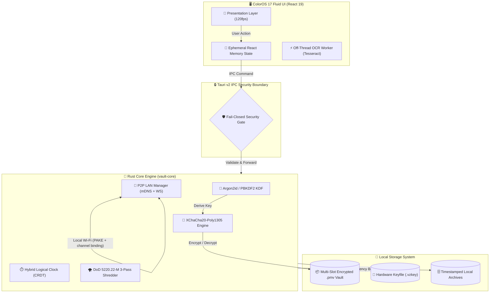

<div align="center">


# 🔒 VaultZero (ভল্টজিরো)
### ColorOS 17 "Living Flow Design" · 120fps GPU-Accelerated · 100% Offline Zero-Knowledge Fortress

**Blazing-fast, zero-telemetry desktop & mobile password manager built with Rust, Tauri 2 & React 19.**  
*Military-grade XChaCha20-Poly1305 & Argon2id encryption · P2P LAN Serverless Sync · Master Password Recovery Wizard · Offline OCR scanner (Eng + বাংলা) · RFC 6238 2FA TOTP authenticator · Air-Gapped by Design · Procedural Lo-Fi Soundscape · Full English & বাংলা (Native Bangla).*

---

[](https://github.com/tonmoycoder/VaultZero/releases/latest)
[](https://www.rust-lang.org/)
[](https://v2.tauri.app/)
[](https://react.dev/)
[](https://tailwindcss.com/)
[](./SECURITY.md)
[](./LICENSE)

---

### 🌐 Language Selection / ভাষা নির্বাচন
**[🇬🇧 English Documentation](#-english-documentation)** &nbsp;|&nbsp; **[🇧🇩 বাংলা ডকুমেন্টেশন (Bangla Guide)](#-বাংলা-ডকুমেন্টেশন-bangla-guide)**

</div>

---

## 📥 Direct Downloads / সরাসরি ডাউনলোড লিংক

> **No developer tools required.** You do **not** need Docker, Node.js, Rust, a
> browser, or an internet connection to *use* VaultZero. Download one file and
> run it. Both builds are **standalone native applications**: Windows opens its
> own Tauri/WebView2 window (never a browser tab), and Android installs as a
> normal APK with its own encrypted local vault.

| Platform | Direct link (always the *latest* release) | What it is |
|:---|:---|:---|
| 🪟 **Windows (recommended)** | [**VaultZero-Windows-x64-Setup.exe**](https://github.com/tonmoycoder/VaultZero/releases/latest/download/VaultZero-Windows-x64-Setup.exe) | NSIS installer; Start-menu + desktop shortcut; preserves your vault on upgrade |
| 💼 **Windows portable** | [**VaultZero-Windows-x64-Portable.exe**](https://github.com/tonmoycoder/VaultZero/releases/latest/download/VaultZero-Windows-x64-Portable.exe) | One standalone `.exe`, zero install, USB-friendly |
| 🏢 **Windows MSI** | [**VaultZero-Windows-x64.msi**](https://github.com/tonmoycoder/VaultZero/releases/latest/download/VaultZero-Windows-x64.msi) | Silent / managed deployment |
| 🤖 **Android (arm64)** | [**VaultZero-Android.apk**](https://github.com/tonmoycoder/VaultZero/releases/latest/download/VaultZero-Android.apk) | Signed release APK, installable directly, works fully offline |
| 🔐 **Checksums** | [**SHA256SUMS.txt**](https://github.com/tonmoycoder/VaultZero/releases/latest/download/SHA256SUMS.txt) | One combined `sha256sum` manifest for **all** of the above |

These names are a **stable contract**. `.github/workflows/release.yml` emits
exactly these files on every tag, `README.md` links to them, and the in-app
updater (`src/lib/updater.ts`) verifies them against `SHA256SUMS.txt` before it
installs anything. On Android the updater picks the `.apk`; on Windows it picks
the NSIS `.exe` — never the wrong platform.

Verify a manual download with:

```bash
sha256sum -c SHA256SUMS.txt --ignore-missing
```

- 🔗 [**All releases & release notes**](https://github.com/tonmoycoder/VaultZero/releases/latest)
- 📱 The Android release also publishes a versioned copy
  (`VaultZero-<tag>-Android-arm64.apk`) for archival; the stable URL above is
  the one the app and this README use.

---

## 🖥️ Two standalone apps, one optional sync

Windows and Android are **independent**. Each one creates and keeps its own
`local-vault.pmv` in the app data directory, works with no network at all, and
never requires the other device. That is the fail-closed default.

If you *want* the same data on both, open **Sync** and use P2P LAN sync:
X25519 key exchange, a 6-digit ephemeral PIN, transcript channel binding, and
XChaCha20-Poly1305 encrypted payloads. **Receive & Merge** merges by item id
with local-wins conflict resolution (`src/lib/p2pMerge.ts`), bounded to 8 MB /
5,000 entries / 4,096 characters per field. No cloud account, no server, no
plaintext on the wire. The QR panel is gated behind a real live pairing code —
it never renders a fake placeholder code as a QR image.

---

## 🔄 Auto-update without losing your vault

1. On startup the app checks GitHub releases **when the main thread is idle**
   (it does not block first paint), and shows `Update available: vX.Y.Z`.
2. **Settings → Check for Updates** runs a manual check; the result is cached
   for 5 minutes so repeated clicks do not hammer the API.
3. **Download & Install** fetches the asset from `github.com` /
   `objects.githubusercontent.com` over HTTPS, streams it, verifies the SHA-256
   against the signed `SHA256SUMS.txt` manifest, and only then writes it via the
   Rust `save_update_artifact` IPC command. A mismatched or oversized download
   is discarded — **fail closed**, no fake fallback.
4. On Windows the verified NSIS installer is launched with `start /wait` on a
   background thread, and `AppHandle::restart()` starts the new build only
   *after* the installer exits. On Android the verified APK is saved to app data
   and its path is surfaced — Android does not allow silent APK installation.
5. Data safety is layered: the vault lives in the **app data directory**, never
   inside the install directory, so an installer cannot overwrite it. A second
   snapshot is taken before the download (before, not after); if a failed
   update leaves the container unreadable, `restorePreUpdateBackupIfNeeded()`
   (`src/lib/updater.ts`) puts it back on the next start. The snapshot is
   cleared **only after a successful unlock**, never at startup.

---

## 🔑 Genuine 2FA & the emergency kit

`src/lib/totp.ts` is a real RFC 6238 / RFC 4226 implementation using WebCrypto
HMAC-SHA1, Base32 secrets, `otpauth://` URI parsing, and the official RFC test
vectors. `VaultItem.totp` stores the **Base32 setup secret**; every surface that
shows a *code* derives it live with `useLiveTotpCode()` and refreshes on the
30-second period boundary. The setup secret is never displayed as a code, never
printed into "Copy All" (`buildFormattedQuickCopy`), and never logged. Recovery
codes are likewise excluded from bulk copy. If a stored secret is invalid, the
UI shows `••• •••` instead of guessing a code.

The **Emergency Kit** (`Settings → Tools → Emergency Kit`) is a printable A4
*blank template*: you write your master password hint, 24-character recovery
key and 2FA setup keys **by hand**, so no secret is ever sent to a printer
spooler or written to disk by the app. Each generated kit receives a unique
CSPRNG document ID. To recover a vault, use the **Recovery Key** wizard in the
lock screen — the kit is an offline reminder, not a separately encrypted file
format.

---

## ⚡ Cold start, physics & complexity

- The `.exe` starts a native Tauri window with no browser tab, no dev server
  and no startup network request. The release check is deferred to
  `requestIdleCallback`; the Web Audio / Lo-Fi engine is `React.lazy`-loaded
  only when zen mode is opened. The main JS chunk is guarded by
  `scripts/check-bundle-size.mjs`.
- ColorOS-style physics is measured, not faked: `src/lib/gesturePhysics.ts`
  computes speed from real pointer samples (`speedFromSamples`), clamps it,
  applies `rubberBand` resistance and `speedResponsiveSpring`, and records the
  last rebound in `data-elastic-state` / `data-last-rebound`. A very fast but
  tiny flick can no longer fling a whole sheet away, and a post-drag click on
  the sheet handle is suppressed so a gentle partial drag always springs back.
- Complexity of the hot paths (see `docs/AUDIT-2026-11.md` for the full
  analysis): search is `O(n·m)` over `n` items and `m` characters of the query
  with `O(1)` extra memory; P2P merge is `O(n+m)` time / `O(n+m)` memory for a
  single id-union pass; CRDT clock advancement is `O(1)` time and memory via a
  single saturating `AtomicU64` CAS; TOTP is `O(1)` time and memory per code
  (one HMAC); the updater streams in `O(1)` buffers with `O(size)` disk I/O and
  verifies the digest incrementally.

---

## ✅ Verify a checkout

```bash
npm ci
npx tsc --noEmit
npm run verify                 # harness tests, contrast, rustfmt, bundle budget
npx playwright test           # full end-to-end suite
npm audit --audit-level=high
cargo test --package vault-core
cargo clippy --all-targets -- -D warnings
```

CI runs the Rust gates on `windows-latest` and the Playwright suite on
`ubuntu-latest`; the release workflow builds the NSIS/MSI Windows binaries and
the signed Android APK from the same commit.

---

# 🇬🇧 English Documentation

## 🌟 Overview

**VaultZero** is an open-source, air-gapped password manager and zero-knowledge digital vault engineered from the ground up for individuals and organizations demanding uncompromising cryptographic privacy without surrendering keys to centralized cloud corporations.

---

## 🛡️ Unhackable Threat Model & Cryptographic Guarantees

VaultZero operates on an unhackable **Fail-Closed Air-Gapped Security Architecture**:

| Security Layer | Cryptographic Specification | Attack Resistance |
|:---|:---|:---|
| **Key Derivation (KDF)** | **Argon2id** (Memory-hard: 64 MiB RAM, 3 iterations, 4 parallelism lanes) | ASIC, GPU cluster, and FPGA brute-force dictionary immunity |
| **Symmetric Cipher** | **XChaCha20-Poly1305** (256-bit key, 192-bit extended nonce) | Quantum-resistant stream cipher, zero nonce-reuse vulnerability |
| **Envelope Architecture** | **Multi-Slot AAD Header Masking** (`.pmv` format) | Tamper-evident authenticated data; bit-flip attempts immediately fail-closed |
| **Zero-Knowledge Memory** | **Memory Zeroization & DoD 5220.22-M 3-Pass Shredder** | Cold-boot memory scraping and forensic disk carving defense |
| **P2P Transport** | **PAKE-style Handshake + Transcript Channel Binding + XChaCha20-Poly1305** | Active Man-in-the-Middle (MitM) rejection across untrusted Wi-Fi; payload never leaves the host in cleartext |
| **System Boundary** | **Fail-Closed IPC Gate (Rust 🦀)** | Strict boundary isolation; renderer compromises cannot extract plaintext |

---

## 🚀 Core Features Matrix (v2.5.0)

### 1. 📡 Military-Grade P2P LAN Sync (Zero Cloud)
*   **Serverless Local Transfer:** Sync credentials between desktop and mobile devices over local Wi-Fi without any third-party cloud servers.
*   **mDNS Auto-Discovery:** Broadcasts on `_vaultzero._tcp.local.` with ephemeral socket binding.
*   **Constant-Time Ephemeral PIN:** High-security 6-digit ephemeral pairing with `subtle::ConstantTimeEq` timing-attack mitigation, bound into the key schedule before the shared secret is used.
*   **Authenticated Key Exchange:** X25519 ephemeral exchange with a **transcript channel-binding hash** that both peers must verify — a man-in-the-middle that substitutes a key is rejected before any vault data is released.
*   **Encrypted Payload:** The vault snapshot is sealed with XChaCha20-Poly1305 (direction-separated keys) *before* it reaches the socket. Plaintext never crosses the wire.
*   **Encrypted-Only Transmission:** Plaintext never crosses the network wire; only authenticated, encrypted `.pmv` payloads are transferred.

### 2. 🎨 ColorOS 17 "Living Flow Design" (120fps UI)
*   **Lag-Free 120Hz Animations:** GPU-accelerated fluid cubic-bezier curves (`--ease-out-fluid`, `--ease-in-out-flow`).
*   **Isolated TOTP Ticker (`React.memo`):** Micro-component countdown boundaries isolate 1-second interval updates, preventing dashboard re-renders and frame drops.
*   **Tactile Micro-Haptics:** Interactive scale springs (`whileHover: scale 1.012`, `whileTap: scale 0.965`).
*   **Canvas Throttling:** 30fps background audio visualizer throttler with automatic tab pause guard.

### 3. 🔍 Zero-API Offline OCR (Tesseract in Web Worker)
*   **100% Offline Credential Extraction:** Bundled `eng.traineddata` (English) and `ben.traineddata` (বাংলা) directly inside `public/tessdata/`.
*   **Off-Thread Web Worker:** Executes image recognition in a background worker thread (`src/workers/ocr.worker.ts`), keeping the UI responsive at 120fps.
*   **Smart Regex Entity Classification:** Automatically parses and assigns URLs, usernames, passwords, and 2FA secrets without external API calls.

### 4. 🔑 Master Password Recovery & Keyfile Wizard
*   **24-Character Recovery Key (`VZRO-XXXX-XXXX-XXXX-XXXX-XXXX`):** Cryptographically unwraps the vault using an independent recovery KEK slot if the master password is forgotten.
*   **Hardware Keyfile (`.vzkey`):** Generates 32 bytes of CSPRNG hardware entropy for air-gapped two-factor vault locking.
*   **Safe Emergency Reset:** Guaranteed zero accidental data loss; creates a timestamped archive (`vaultzero_archived_<timestamp>`) before initializing a clean vault.

### 5. 🛡️ Zero-Knowledge Breach Scanner
*   **Offline K-Anonymity Checks:** SHA-1 prefix matching via local Bloom filters; checks password breach exposure without exposing any password bits to third parties.

---

## 🏛️ System Architecture Workflow



---

## 💻 Developer & Source Build Guide

```bash
# 1. Clone the repository
git clone https://github.com/tonmoycoder/VaultZero.git
cd VaultZero

# 2. Install frontend dependencies
npm install

# 3. Start local development server (Port 1420)
npm run dev

# 4. Run automated tests (Rust core + Playwright)
cargo test --package vault-core
npx playwright test

# 5. Build production Windows binary
npm run build
npx tauri build
```

---

# 🇧🇩 বাংলা ডকুমেন্টেশন (Bangla Guide)

## 🌟 পরিচিতি

**ভল্টজিরো (VaultZero)** হলো ১০০% অফলাইন, জিরো-নলেজ ও অত্যন্ত দ্রুতগতির ডেস্কটপ ও মোবাইল পাসওয়ার্ড ম্যানেজার। ক্লাউড সার্ভারের ওপর নির্ভরশীল পাসওয়ার্ড ম্যানেজারগুলোর নিরাপত্তা ঝুঁকি দূর করতে এটি আপনার ডিভাইসেই মিলিটারি-গ্রেড ক্রিপ্টোগ্রাফিতে সমস্ত ডেটা নিরাপদে সংরক্ষণ করে।

> **সাধারণ ব্যবহারকারীদের জন্য বিশেষ দ্রষ্টব্য:** ভল্টজিরো ব্যবহার করার জন্য Docker, Node.js, Rust বা ব্রাউজারের প্রয়োজন নেই। উইন্ডোজে [`.exe`](https://github.com/tonmoycoder/VaultZero/releases/latest/download/VaultZero-Windows-x64-Setup.exe) এবং অ্যান্ড্রয়েডে [`.apk`](https://github.com/tonmoycoder/VaultZero/releases/latest/download/VaultZero-Android.apk) ডাউনলোড করলেই হলো — দুটিই সম্পূর্ণ স্বতন্ত্র নেটিভ অ্যাপ, ব্রাউজার ট্যাব নয়।

---

## ✨ প্রধান প্রযুক্তিগত সুবিধাসমূহ (v2.5.0)

1. **মিলিটারি-গ্রেড লোকাল P2P সিঙ্ক (P2P LAN Sync):**
   - ক্লাউড সার্ভার ছাড়া লোকাল ওয়াই-ফাইয়ের মাধ্যমে ডেস্কটপ ও মোবাইলের মাঝে নিরাপদ ভল্ট সিঙ্ক।
   - ৬-ডিজিটের এফিমোরাল পিন এবং কনস্ট্যান্ট-টাইম অথেন্টিকেশনের মাধ্যমে ম্যান-ইন-দ্য-মিডল অ্যাটাক থেকে সম্পূর্ণ নিরাপদ।
   - নেটওয়ার্কে কখনোই প্লেইনটেক্সট পাঠানো হয় না; শুধুমাত্র এনক্রিপ্টেড `.pmv` পেলোড আদান-প্রদান করা হয়।

2. **ColorOS 17 "লিভিং ফ্লো ডিজাইন" (১২০fps UI):**
   - স্প্রিং ফিজিক্স ও ফ্লুইড অ্যানিমেশন।
   - প্রতি সেকেন্ডের কাউন্টডাউন টিক ড্যাশবোর্ডকে রি-রেন্ডার করে না, ফলে ১২০ হার্টজ রিফ্রেশ রেটেও একটানা মসৃণ পারফরম্যান্স পাওয়া যায়।

3. **জিরো-এপিআই অফলাইন ওসিআর (OCR):**
   - ইংরেজি এবং বাংলা উভয় ভাষার জন্য লোকাল ডেটা ফাইল (`eng.traineddata` ও `ben.traineddata`) সরাসরি অ্যাপে অন্তর্ভুক্ত।
   - ওয়েব ওয়ার্কারের মাধ্যমে অফ-থ্রেডে ইমেজ প্রসেসিং চলায় অ্যাপ একটুও স্লো বা হ্যাং হয় না।

4. **মাস্টার পাসওয়ার্ড রিকভারি ও কি-ফাইল উইজার্ড:**
   - **২৪ অক্ষরের রিকভারি কি (`VZRO-...`):** পাসওয়ার্ড ভুলে গেলেও ভল্ট সুরক্ষিতভাবে আনলক করে নতুন পাসওয়ার্ড সেট করা যায়।
   - **হার্ডওয়্যার কি-ফাইল (`.vzkey`):** ৩২-বাইট র্যান্ডম কি-ফাইলের সাহায্যে টু-ফ্যাক্টর অফলাইন সুরক্ষা।
   - **জিরো ডেটা লস গ্যারান্টি:** যেকোনো বড় পরিবর্তনের আগে স্বয়ংক্রিয় টাইমস্ট্যাম্পড লোকাল ব্যাকআপ তৈরি হয়।

5. **জিরো-নলেজ ব্রিচ স্ক্যানার:**
   - পাসওয়ার্ড হ্যাক হয়েছে কিনা তা অফলাইনে স্থানীয় ব্লুম ফিল্টারের সাহায্যে পরীক্ষা করা যায়।

---

## 📖 ব্যবহার নির্দেশিকা (Quickstart)

১. **অ্যাপটি চালু করুন:** উইন্ডোজে `VaultZero-Windows-x64-Setup.exe` ইনস্টল করুন অথবা `VaultZero-Windows-x64-Portable.exe`-এ ডাবল ক্লিক করুন; অ্যান্ড্রয়েডে `VaultZero-Android.apk` ইনস্টল করুন।  
২. **মাস্টার পাসওয়ার্ড সেট করুন:** একটি শক্তিশালী পাসওয়ার্ড নির্ধারণ করুন (প্রয়োজনে অতিরিক্ত সুরক্ষার জন্য `.vzkey` তৈরি করুন)।  
৩. **ইমার্জেন্সি রিকভারি কি সংরক্ষণ করুন:** পর্দায় প্রদর্শিত ২৪-অক্ষরের `VZRO-...` কোডটি নিরাপদ স্থানে লিখে রাখুন।  
৪. **পাসওয়ার্ড যোগ বা ইম্পোর্ট করুন:** **+ নতুন যোগ করুন** বাটনে চাপুন অথবা Chrome/Bitwarden থেকে সরাসরি CSV ফাইল ইম্পোর্ট করুন।  
৫. **প্যানিক লক:** যেকোনো সময় কিবোর্ডে `Ctrl + L` চাপলে র‍্যামের সমস্ত এনক্রিপশন কি ডিলিট হয়ে ভল্ট তৎক্ষণাৎ লক হয়ে যাবে।

---

## 📜 লাইসেন্স ও নিরাপত্তা (License & Security)

- **লাইসেন্স:** এই প্রজেক্টটি পারমিসিভ [MIT License](./LICENSE)-এর অধীনে উন্মুক্ত।
- **নিরাপত্তা পলিসি:** যেকোনো নিরাপত্তা পর্যালোচনা বা দায়িত্বশীল প্রকাশের জন্য [SECURITY.md](./SECURITY.md) দেখুন।

---

## 🔄 আপডেট ও ডেটা নিরাপত্তা (বাংলা)

নতুন রিলিজ বের হলে অ্যাপ নিজে GitHub থেকে জানায়; **সেটিংস → Check for Updates**-এম্যানুয়ালিভাবেও চেক করা যায়। ডাউনলোডযোগ্য ফাইলটি `SHA256SUMS.txt` দিয়ে যাচাই না হওয়া পর্যন্ত ইনস্টল হয় না। উইন্ডোজে ইনস্টলার শেষ হলে অ্যাপ নিজে আবার চালু হয়; অ্যান্ড্রয়েডে যাচাইকৃত APK অ্যাপের ডেটা ফোল্ডারে সংরক্ষিত হয় (অ্যান্ড্রয়েড নীরবে APK ইনস্টল করতে দেয় না)।

আপনার ভল্ট `local-vault.pmv` ফাইলে **অ্যাপ ডেটা ফোল্ডারে** থাকে, ইনস্টল ফোল্ডারে নয় — তাই আপডেট কখনোই পুরনো ডেটা মুছে দেয় না। আপডেটের আগে আরও একটি এনক্রিপ্টেড স্ন্যাপশট নেওয়া হয়; কোনো কারণে ভল্ট পড়া না গেলে পরের চালুতে সেটি স্বয়ংক্রিয়ভাবে ফেরত আনা হয়, এবং **সফল আনলকের পরেই** কেবল স্ন্যাপশট মোছা হয়।

## 🔑 ২FA ও ইমার্জেন্সি কিট (বাংলা)

২FA আসল RFC 6238 ইঞ্জিন: Base32 সেটআপ কি থেকে WebCrypto HMAC দিয়ে প্রতি ৩০ সেকেন্ডে নতুন কোড তৈরি হয়। সেটআপ কি কখনো কোড হিসেবে দেখানো হয় না, **Copy All**-এ যায় না, লগেও লেখা হয় না। ভুল কি থাকলে কোডের জায়গায় `••• •••` দেখায় — কোনো অনুমান নয়।

**ইমার্জেন্সি কিট** একটি হাতে-লেখা A4 ছক: মাস্টার পাসওয়ার্ড, ২৪-অক্ষরের রিকভারি কি ও ২FA কি আপনি নিজে লিখেন, তাই অ্যাপ কোনো গোপন তথ্য প্রিন্টারে বা ডিস্কে লেখে না। প্রতিটি কিটের নিজস্ব র্যান্ডম ডকুমেন্ট আইডি থাকে। ভল্ট ফিরে পেতে লক স্ক্রিনের **"পাসওয়ার্ড ভুলে গেছেন? ভল্ট রিকভার করুন"** পথে রিকভারি কি ব্যবহার করুন।

## 📥 সরাসরি ডাউনলোড (বাংলা)

| প্ল্যাটফর্ম | লিংক |
|:---|:---|
| 🪟 উইন্ডোজ ইনস্টলার | [VaultZero-Windows-x64-Setup.exe](https://github.com/tonmoycoder/VaultZero/releases/latest/download/VaultZero-Windows-x64-Setup.exe) |
| 💼 উইন্ডোজ পোর্টেবল | [VaultZero-Windows-x64-Portable.exe](https://github.com/tonmoycoder/VaultZero/releases/latest/download/VaultZero-Windows-x64-Portable.exe) |
| 🤖 অ্যান্ড্রয়েড APK | [VaultZero-Android.apk](https://github.com/tonmoycoder/VaultZero/releases/latest/download/VaultZero-Android.apk) |
| 🔐 চেকসাম | [SHA256SUMS.txt](https://github.com/tonmoycoder/VaultZero/releases/latest/download/SHA256SUMS.txt) |
