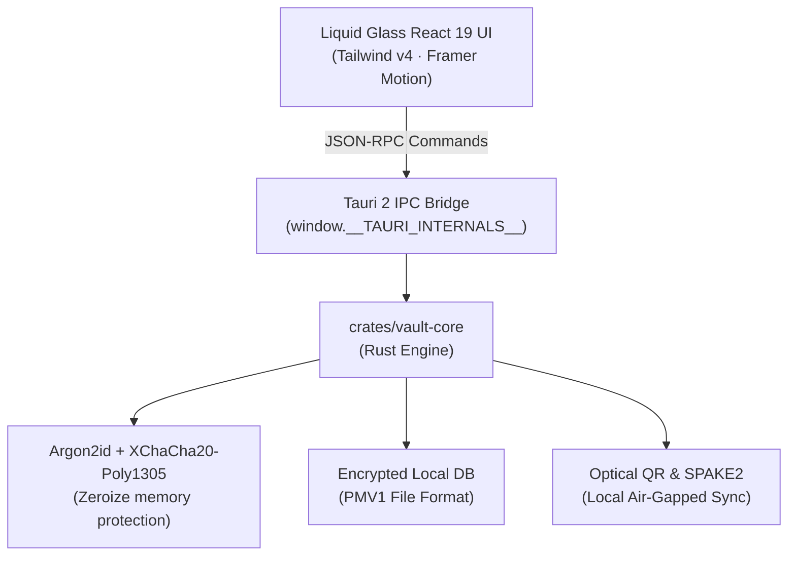

<div align="center">


# 🔒 VaultZero (ভল্টজিরো)
### Apple Liquid Glass Edition · 100% Offline Zero-Knowledge Fortress

**Blazing-fast, zero-telemetry desktop & mobile password manager built with Rust, Tauri 2 & React 19.**  
*Military-grade XChaCha20-Poly1305 & Argon2id encryption · Offline OCR scanner · 2FA TOTP authenticator · P2P SPAKE2 sync · Lo-Fi Zen audio synthesiser · English & বাংলা (Native Bangla).*

---

[](https://github.com/tonmoycoder/VaultZero/releases/latest)
[](https://www.rust-lang.org/)
[](https://v2.tauri.app/)
[](https://react.dev/)
[](https://tailwindcss.com/)
[](./LICENSE)
[](./SECURITY.md)

</div>

---

## 📥 Direct Downloads / সরাসরি ডাউনলোড লিংক

Click any link below to immediately download the standalone binaries:

- 🪟 **Download for Windows (Portable .exe)**:  
  [**VaultZero-Windows-x64-Portable.exe**](https://github.com/tonmoycoder/VaultZero/releases/latest/download/VaultZero-Windows-x64-Portable.exe)  
  *(Ready-to-run single executable for Windows 10 & 11 with Windows Common Controls v6 embedded — no DLL errors)*

- 📦 **Download Windows .zip Bundle**:  
  [**VaultZero-Windows-Installer-Bundle.zip**](https://github.com/tonmoycoder/VaultZero/releases/latest/download/VaultZero-Windows-Installer-Bundle.zip)  
  *(Portable .exe + Quick-Start Guide + License bundle)*

- 📱 **Download Android / Mobile Package**:  
  [**VaultZero-Android-Mobile-Bundle.zip**](https://github.com/tonmoycoder/VaultZero/releases/latest/download/VaultZero-Android-Mobile-Bundle.zip)  
  *(Production mobile app distribution & air-gapped web assets)*

- 🔗 **View All Releases & Assets**:  
  [**https://github.com/tonmoycoder/VaultZero/releases/latest**](https://github.com/tonmoycoder/VaultZero/releases/latest)

---

## 🌟 English Overview

**VaultZero** is an open-source, air-gapped alternative to 1Password, Bitwarden, and KeePassXC designed for users who refuse to entrust their master credentials to centralized corporate clouds.

### 🛡️ Core Highlights
1. **100% Offline & Zero-Telemetry**: Not a single network packet is sent. Your database resides solely in local encrypted storage.
2. **Encrypted Rust Backend (PMV1)**: Key derivation powered by **Argon2id** (64MB memory cost) and authenticated encryption with **XChaCha20-Poly1305**. Plaintext is instantly wiped with memory zeroization (`ZeroizeOnDrop`).
3. **Apple Liquid Glass UI**: Custom spring physics (`framer-motion`), soft glass borders, tactile haptics, responsive drawer/sheet inspector (`<768px` mobile bottom sheet, `768-1279px` drawer, `>=1280px` dock), and font scaling (90%–135%).
4. **Dual OCR (Auto-Fill + Manual Copy-Paste Pad)**: Drag-and-drop or press `Ctrl+V` to scan screenshots locally. Uses regex auto-filling and an interactive `OcrCopyPad` with clickable chips and field assignment buttons.
5. **Secure Official Brand Logos**: Pulls official SVG brand vectors from `simple-icons`. For custom domains, securely queries Google's high-res favicon service (`sz=128`, `no-referrer`, strict SSRF/private IP blocking) with clean monogram fallbacks.
6. **Built-in 2FA TOTP Authenticator**: Instant RFC 6238 time-based tokens with countdown rings and recovery codes.
7. **Local P2P Optical & SPAKE2 Sync**: Air-gapped QR video stream chunking and local Wi-Fi synchronization without third-party relay servers.
8. **Anti-Screen Recording Shield & Clipboard Auto-Clear**: Native Windows `SetWindowDisplayAffinity` blocks screenshots/recordings; copied secrets automatically clear after 12 seconds.
9. **Cozy Lo-Fi Ambient Synthesizer**: Pure Web Audio API procedural synthesizer with real-time AnalyserNode canvas visualizer pill (no external YouTube/streams).

---

## 🇧🇩 বাংলা বিবরণ (বাংলায় পরিচিতি)

**ভল্টজিরো (VaultZero)** হলো ১০০% অফলাইন, জিরো-নলেজ ও অত্যন্ত দ্রুতগতির ডেস্কটপ ও মোবাইল পাসওয়ার্ড ম্যানেজার। এটি ক্লাউডভিত্তিক দুর্বলতা ও ট্র্যাকিং সম্পূর্ণ বর্জন করে আপনার ডিভাইসেই সমস্ত তথ্য সুরক্ষিত রাখে।

### ✨ প্রধান বৈশিষ্ট্যসমূহ:
- **সম্পূর্ণ অফলাইন ও জিরো-ট্র্যাকিং**: কোনো ইন্টারনেট কানেকশন বা ক্লাউড সার্ভারের প্রয়োজন নেই।
- **সামরিক মানের এনক্রিপশন**: Argon2id + XChaCha20-Poly1305 দিয়ে আপনার সমস্ত ডাটা সুরক্ষিত এবং র্যাম থেকে তাত্ক্ষণিক ডেটা মুছে ফেলা হয়।
- **ডুয়াল ওসিআর স্ক্যানার (Auto-Fill + Copy Pad)**: যেকোনো স্ক্রিনশট ড্র্যাগ-অ্যান্ড-ড্রপ বা `Ctrl+V` দিয়ে পেস্ট করলে স্বয়ংক্রিয়ভাবে টাইটেল, ইউজারনেম, পাসওয়ার্ড ও ওয়েবসাইট পূরণ হয়ে যায়; পাশাপাশি এডিটেবল প্যাড ও ক্লিকেবল চিপস দিয়ে যেকোনো ঘরে তথ্য বসানো যায়।
- **অফিশিয়াল লোগো ফেচার**: সাধারণ ব্রাউজিংয়ের জন্য simple-icons এবং বৈধ ডোমেইনের জন্য গুগল হাই-রেজুলিউশন সার্ভিস থেকে নিরাপদ HTTPS লোগো প্রদর্শন; ভুল কোম্পানির লোগো কখনো দেখায় না।
- **স্বাভাবিক ও প্রাঞ্জল বাংলা ভাষা**: যেকোনো সময় এক ক্লিকেই পুরো ইন্টারফেস প্রাঞ্জল বাংলায় রূপান্তর করা যায়।
- **অ্যান্টি-রেকর্ডিং শিল্ড ও অটো-ক্লিপবোর্ড ক্লিয়ার**: কোনো স্ক্রিন রেকর্ডার বা স্পাইওয়্যার অ্যাপের ভেতরে থাকা পাসওয়ার্ড রেকর্ড করতে পারে না এবং ক্লিপবোর্ড থেকে ১২ সেকেন্ডের মধ্যে সংবেদনশীল তথ্য স্বয়ংক্রিয়ভাবে মুছে যায়।
- **লোফি অ্যাম্বিয়েন্ট সিন্থেসাইজার**: কোনো ইউটিউব ভিডিও ছাড়া সম্পূর্ণ নিজস্ব অডিও কোডে তৈরি রিল্যাক্সিং সাউন্ড ও লাইভ ক্যানভাস ভিজ্যুয়ালাইজার।

---

## 🛠️ Tech Stack & Architecture



---

## 💻 Running Locally

### Prerequisites
- [Node.js](https://nodejs.org/) v20+
- [Rust](https://rustup.rs/) v1.80+

```bash
# Clone the repository
git clone https://github.com/tonmoycoder/VaultZero.git
cd VaultZero

# Install dependencies
npm install

# Run Vite web development server
npm run dev

# Run Playwright end-to-end tests
npx playwright test

# Build desktop release executable
cargo build --release -p vaultzero-app
```

---

## 📜 License & Security

- **License**: Released under the permissive [MIT License](./LICENSE).
- **Security Policy**: For responsible vulnerability disclosure, please refer to [SECURITY.md](./SECURITY.md).
