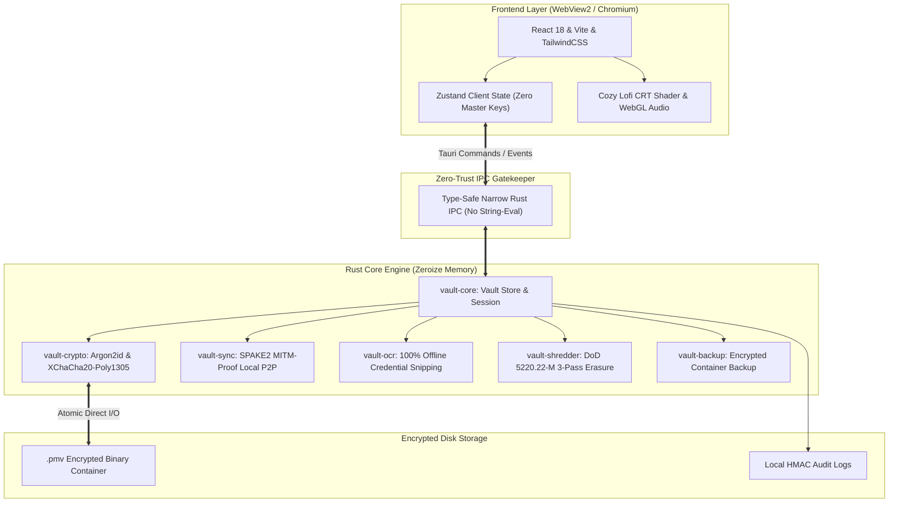
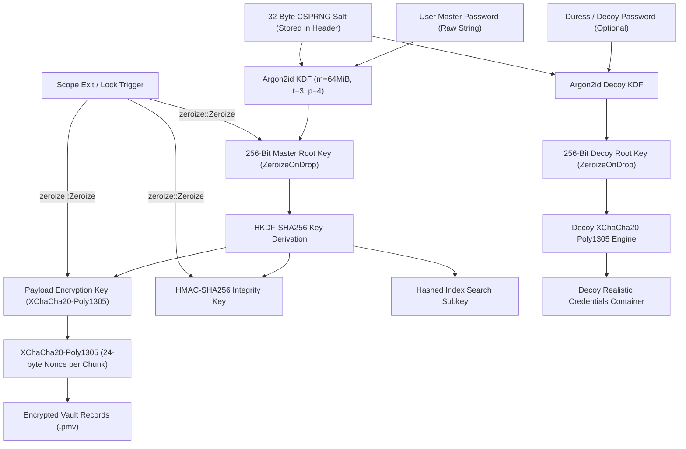

<div align="center">

# 🛡️ VaultZero

**The 100% Offline, Zero-Trust, Self-Sovereign Identity & Secrets Fortress with Cozy Aesthetics.**

[](https://www.rust-lang.org/)
[](https://v2.tauri.app/)
[](https://react.dev/)
[](./LICENSE)
[](#multi-platform-support)
[](./SECURITY.md)

<p align="center">
  <a href="#key-features">Key Features</a> •
  <a href="#system-architecture">Architecture</a> •
  <a href="#cryptographic-key-hierarchy">Cryptography</a> •
  <a href="#keyboard-shortcuts">Shortcuts</a> •
  <a href="#quick-start--installation">Installation</a> •
  <a href="#building-from-source">Build from Source</a> •
  <a href="#contributing">Contributing</a>
</p>

---

</div>

## 🌟 Why VaultZero?

Most password managers force you into the cloud, turning your master credentials into remote targets for data breaches, subscriptions, and outages. 

**VaultZero** rejects the cloud paradigm completely:
- **Zero Cloud, Zero Telemetry**: 100% offline. Not a single byte ever leaves your machine without your explicit authorization.
- **Zero-Trust Memory Hygiene**: All keys and plaintext are scrubbed with `ZeroizeOnDrop`.
- **Cozy & High-Performance**: Boots instantly, feels smooth at 60fps, and features a retro CRT shader and built-in relaxing lofi soundscapes.

---

## 🚀 Key Features

### 🛡️ 1. 100% Offline & Absolute Air-Gap
No telemetry, no remote servers, no analytics scripts, no tracking. VaultZero functions completely severed from the internet. Your encrypted vault (`.pmv`) remains purely on your local drives or personal USB keys.

### 🔒 2. Zero-Trust Narrow IPC Boundary
Engineered with Tauri v2 and Rust. The frontend JavaScript WebView never has access to raw cryptographic keys or filesystem paths. Every command is strictly typed and validated before reaching the Rust core.

### 🎭 3. Duress Decoy Vault
Subject to coercion or forced unlock? Enter your pre-configured **Duress Password**. VaultZero derives an independent decoy subkey and instantly displays an authentic-looking, populated dummy vault while your real credentials remain undetectable and protected.

### 🔄 4. MITM-Proof Local P2P Sync (SPAKE2 + LAN)
Sync your credentials across your laptop, desktop, and mobile devices directly over your local Wi-Fi / LAN using **SPAKE2 (RFC 9383)** password-authenticated key exchange. No third-party relays, servers, or cloud storage required.

### 📷 5. Offline OCR Snipping (`Ctrl+Shift+S`)
Extract credentials, Wi-Fi keys, and recovery codes directly from screen regions or image files without typing. Processed completely offline on your CPU with zero external API calls.

### ☕ 6. Cozy Lofi Shader Mode & Ambient Player
Security doesn't have to be sterile. Toggle between clean modern themes and a nostalgic **Lofi CRT Scanline Shader** mode, complete with an offline, synthesized lofi soundscape player for calm and focused work sessions.

### 💥 7. DoD 5220.22-M 3-Pass Secure File Shredder
Need to eliminate sensitive documents? The built-in file shredder performs US Department of Defense 3-pass overwriting (`0x00`, `0xFF`, CSPRNG pseudorandom noise) before unlinking, preventing forensic file recovery.

---

## 🏛️ System Architecture



---

## 🔐 Cryptographic Key Hierarchy



---

## ⌨️ Keyboard Shortcuts

| Shortcut | Action | Description |
| :--- | :--- | :--- |
| <kbd>Ctrl</kbd> + <kbd>K</kbd> | **Command Palette** | Instant global search across passwords, notes, credit cards, and tags. |
| <kbd>Ctrl</kbd> + <kbd>L</kbd> | **Panic Lock** | Instantly purges memory keys with zeroize and returns to master unlock screen. |
| <kbd>Ctrl</kbd> + <kbd>Shift</kbd> + <kbd>S</kbd> | **Offline OCR Snip** | Freeze screen and snip a region to extract textual credentials locally. |
| <kbd>Ctrl</kbd> + <kbd>N</kbd> | **New Secret** | Opens modal to create a new password or identity record. |
| <kbd>Ctrl</kbd> + <kbd>Shift</kbd> + <kbd>D</kbd> | **Toggle Cozy Lofi** | Switches between clean modern mode and retro CRT scanline shader mode. |
| <kbd>Ctrl</kbd> + <kbd>Shift</kbd> + <kbd>Y</kbd> | **P2P Sync Center** | Opens the SPAKE2 local peer-to-peer sync pairing dialog. |

---

## 📦 Quick Start & Installation

### Windows Portable (`.exe`)
1. Download the latest `VaultZero-Windows-x64.exe` from [GitHub Releases](https://github.com/tonmoycoder/vaultzero/releases).
2. Place it anywhere (e.g. `Desktop`, `USB Drive`).
3. Run the executable — zero installation, zero drivers, zero registry changes.

### Mobile & Android
- Grab the pre-built `VaultZero-Android-universal.apk` directly from [Releases](https://github.com/tonmoycoder/vaultzero/releases) or use the offline PWA package.

---

## 🛠️ Building from Source

### Prerequisites
- **Node.js** (v18.0+) & **npm**
- **Rust Toolchain** (1.78+ stable): `rustup default stable`
- **C++ Build Tools** (Visual Studio Build Tools on Windows)

### 1. Clone & Install Dependencies
```bash
git clone https://github.com/tonmoycoder/vaultzero.git
cd vaultzero
npm install
```

### 2. Run Local Development Server
```bash
npm run tauri dev
```

### 3. Build Windows Standalone Portable Binary
```bash
npm run build
cargo build --release --manifest-path src-tauri/Cargo.toml
```
The compiled binary will be ready at:
```
target/release/vaultzero-app.exe
```

### 4. Build Android APK (Tauri Mobile)
```bash
# Initialize Android configuration (first time only)
npm run tauri android init

# Build debug or release APK
npm run tauri android build --apk
```

---

## 🧪 Running Automated Tests

Run the full Rust cryptographic and core workspace test suite:
```bash
cargo test --workspace
```

Verify frontend TypeScript and Vite bundling:
```bash
npm run build
```

---

## 🔒 Security Model & Bug Bounty

For full cryptographic threat modeling, audit principles, and vulnerability disclosure policies, review [SECURITY.md](./SECURITY.md).

---

## 🤝 Contributing

We welcome contributions from developers, security researchers, and designers! Please read our [CONTRIBUTING.md](./CONTRIBUTING.md) guide before submitting pull requests.

---

## 📄 License

VaultZero is free and open-source software licensed under the **[MIT License](./LICENSE)**.  
Copyright © 2026 **Tonmoy Islam** ([@tonmoycoder](https://github.com/tonmoycoder)).

