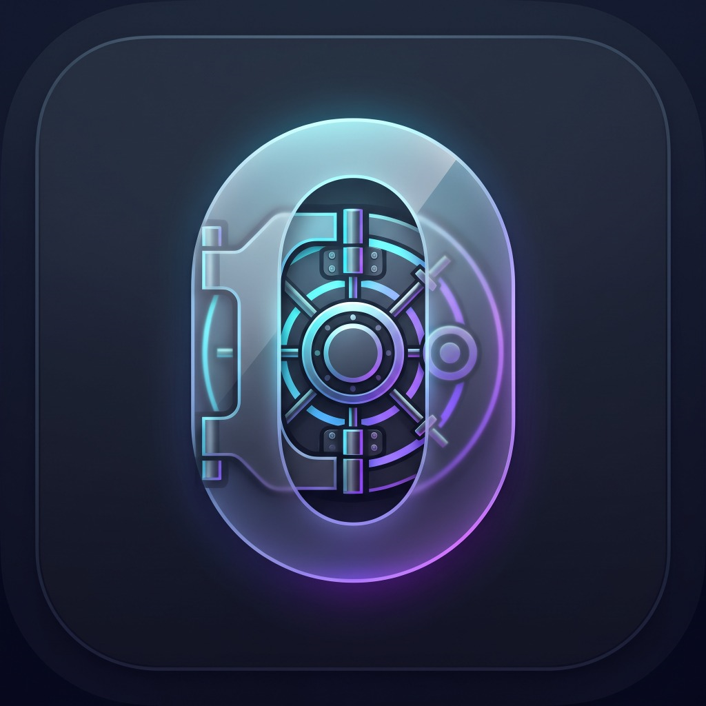
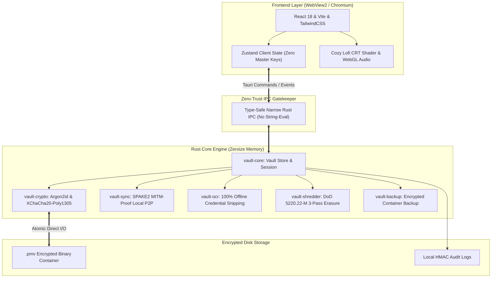
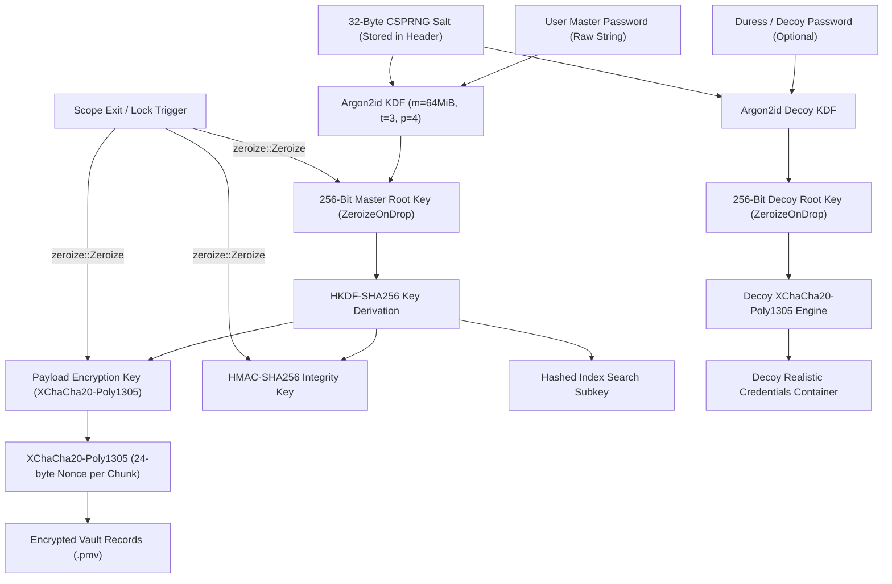

<div align="center">



# 🛡️ VaultZero

**The 100% Offline, Zero-Trust, Self-Sovereign Identity & Secrets Fortress with Cozy Aesthetics.**

[](https://github.com/tonmoycoder/vaultzero/releases/latest)
[](https://www.rust-lang.org/)
[](https://v2.tauri.app/)
[](https://react.dev/)
[](./LICENSE)
[](#-download--install)
[](./SECURITY.md)

<p align="center">
  <a href="#-download--install">Download & Install</a> •
  <a href="#-key-features">Key Features</a> •
  <a href="#-system-architecture">Architecture</a> •
  <a href="#-cryptographic-key-hierarchy">Cryptography</a> •
  <a href="#-how-to-run-locally">Run Locally</a> •
  <a href="#-contributing">Contributing</a>
</p>

---

</div>

## 📥 Download & Install

Get the official compiled binaries directly from our [**GitHub Latest Release**](https://github.com/tonmoycoder/vaultzero/releases/latest):

| Platform | Format | Direct Download | Description |
| :--- | :--- | :--- | :--- |
| **Windows 10 / 11** | **NSIS Installer (`.setup.exe`)** | [📥 **Download Windows Setup**](https://github.com/tonmoycoder/vaultzero/releases/latest) | **Recommended.** One-click guided installer with automatic desktop & start menu shortcuts. |
| **Windows 10 / 11** | **Enterprise MSI (`.msi`)** | [📥 **Download Windows MSI**](https://github.com/tonmoycoder/vaultzero/releases/latest) | Official Windows Installer package for silent or enterprise rollouts. |
| **Windows Portable** | **Standalone (`.exe`)** | [📥 **Download Portable `.exe`**](https://github.com/tonmoycoder/vaultzero/releases/latest) | Run straight from USB drives or air-gapped workstations without installation. |
| **Android** | **Universal APK (`.apk`)** | [📥 **Download Android APK**](https://github.com/tonmoycoder/vaultzero/releases/latest) | Sideload directly on Android phones and tablets (ARM64 & x86_64). |
| **Mobile Web** | **Air-Gapped PWA (`.zip`)** | [📥 **Download Offline PWA**](https://github.com/tonmoycoder/vaultzero/releases/latest) | Static progressive web application for offline mobile browsers. |

> [!TIP]
> **Windows Security Note:** Because VaultZero is open-source and built transparently on GitHub Actions, Windows SmartScreen may display an *"Unknown Publisher"* notification on first launch. Click **"More Info"** ➔ **"Run anyway"**.

---

## 🌟 Why VaultZero?

Most password managers force you into the cloud, turning your master credentials into remote targets for data breaches, vendor lock-in, and server outages. 

**VaultZero** rejects the cloud paradigm completely:
- **Zero Cloud, Zero Telemetry**: 100% offline. Not a single byte ever leaves your machine without your explicit authorization.
- **Zero-Trust Memory Hygiene**: All keys and plaintext are scrubbed immediately from RAM with `ZeroizeOnDrop`.
- **Cozy & High-Performance**: Boots instantly, feels ultra-responsive at 60fps, and features a retro CRT shader and built-in relaxing lofi soundscapes.

---

## 🚀 Key Features

### 🛡️ 1. 100% Offline & Absolute Air-Gap
No telemetry, no remote servers, no analytics scripts, no tracking. VaultZero functions completely severed from the internet. Your encrypted vault (`.pmv`) remains purely on your local drives or personal USB keys.

### 🔒 2. Zero-Trust Narrow IPC Boundary
Engineered with Tauri v2 and Rust. The frontend JavaScript WebView never has access to raw cryptographic keys or filesystem paths. Every command is strictly typed and validated before reaching the Rust core.

### 🎭 3. Duress Decoy Vault
Subject to coercion or forced unlock? Enter your pre-configured **Duress Password**. VaultZero derives an independent decoy subkey and instantly displays an authentic-looking, populated dummy vault while your real credentials remain undetectable and protected.

### 🔄 4. MITM-Proof Local P2P Sync (SPAKE2 + LAN)
Sync your credentials across your laptop, desktop, and mobile devices directly over your local Wi-Fi / LAN using **SPAKE2 (RFC 9383)** password-authenticated key exchange. No third-party relays, servers, or cloud storage required.

### 📷 5. Offline OCR Snipping (`Ctrl+Shift+S`)
Extract credentials, Wi-Fi keys, and recovery codes directly from screen regions or image files without typing. Processed completely offline on your CPU with zero external API calls.

### ☕ 6. Cozy Lofi Shader Mode & Ambient Player
Security doesn't have to be sterile. Toggle between clean modern themes and a nostalgic **Lofi CRT Scanline Shader** mode, complete with an offline, synthesized lofi soundscape player for calm and focused work sessions.

### 💥 7. DoD 5220.22-M 3-Pass Secure File Shredder
Need to eliminate sensitive documents? The built-in file shredder performs US Department of Defense 3-pass overwriting (`0x00`, `0xFF`, CSPRNG pseudorandom noise) before unlinking, preventing forensic file recovery.

---

## 🏛️ System Architecture



---

## 🔐 Cryptographic Key Hierarchy



---

## ⌨️ Keyboard Shortcuts

| Shortcut | Action | Description |
| :--- | :--- | :--- |
| <kbd>Ctrl</kbd> + <kbd>K</kbd> | **Command Palette** | Instant global search across passwords, notes, credit cards, and tags. |
| <kbd>Ctrl</kbd> + <kbd>L</kbd> | **Panic Lock** | Instantly purges memory keys with zeroize and returns to master unlock screen. |
| <kbd>Ctrl</kbd> + <kbd>Shift</kbd> + <kbd>S</kbd> | **Offline OCR Snip** | Freeze screen and snip a region to extract textual credentials locally. |
| <kbd>Ctrl</kbd> + <kbd>N</kbd> | **New Secret** | Opens modal to create a new password or identity record. |
| <kbd>Ctrl</kbd> + <kbd>Shift</kbd> + <kbd>D</kbd> | **Toggle Cozy Lofi** | Switches between clean modern mode and retro CRT scanline shader mode. |
| <kbd>Ctrl</kbd> + <kbd>Shift</kbd> + <kbd>Y</kbd> | **P2P Sync Center** | Opens the SPAKE2 local peer-to-peer sync pairing dialog. |

---

## 💻 How to Run Locally

Running VaultZero locally for development is fast and straightforward.

### 1. Prerequisites
- **Node.js** (v18.0 or newer) & **npm**: [Download Node.js](https://nodejs.org/)
- **Rust** (v1.78+ stable): [Install Rust via rustup](https://rustup.rs/)
- **Windows C++ Compiler**: Visual Studio Build Tools (C++ Desktop development) or LLVM-MinGW

### 2. Setup & Development
```bash
# 1. Clone the repository
git clone https://github.com/tonmoycoder/vaultzero.git
cd vaultzero

# 2. Install dependencies
npm install

# 3. Launch in development mode (starts Vite + Tauri desktop window)
npm run tauri dev
```

### 3. Build Windows Installer & Executable Locally
```bash
# Compile web frontend and generate Windows installers (.msi and .setup.exe)
npm run tauri build
```
Generated installers will be located in:
- `src-tauri/target/release/bundle/nsis/` (NSIS Setup installer)
- `src-tauri/target/release/bundle/msi/` (WiX MSI installer)

---

## 🧪 Testing

Execute the workspace unit test suite:
```bash
cargo test --workspace
```

Verify frontend TypeScript type safety:
```bash
npm run build
```

---

## 🤝 How to Contribute

We welcome contributions from everyone! Whether you are fixing a typo, improving cryptographic performance, or designing retro shader themes:

1. **Fork the Repository**: Click "Fork" at the top right of this page.
2. **Create a Feature Branch**:
   ```bash
   git checkout -b feature/awesome-addition
   ```
3. **Commit your Changes**:
   ```bash
   git commit -m "feat: add biometric quick-unlock on supported hardware"
   ```
4. **Push to your Branch**:
   ```bash
   git push origin feature/awesome-addition
   ```
5. **Open a Pull Request**: Submit your PR with a clear summary of your changes. Check [CONTRIBUTING.md](./CONTRIBUTING.md) for style conventions and security checklists.

---

## 🔒 Security Policy

For security vulnerability disclosures, threat models, and safe key management details, please refer to our [SECURITY.md](./SECURITY.md).

---

## 📄 License

VaultZero is free, libre, and open-source software distributed under the **[MIT License](./LICENSE)**.  
Copyright © 2026 **Tanver Islam Tonmoy** ([@tonmoycoder](https://github.com/tonmoycoder)).
