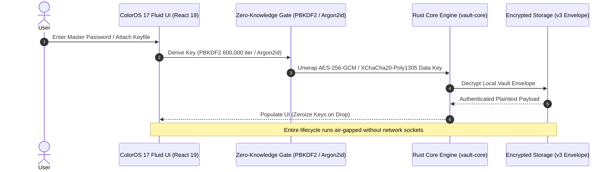

<div align="center">


# 🔒 VaultZero (ভল্টজিরো)
### ColorOS 17 "Living Flow Design" · 120fps GPU-Accelerated · 100% Offline Zero-Knowledge Fortress

**Blazing-fast, zero-telemetry desktop & mobile password manager built with Rust, Tauri 2 & React 19.**  
*Military-grade XChaCha20-Poly1305 & Argon2id encryption · Master Password Recovery Wizard · Offline OCR scanner · RFC 6238 2FA TOTP authenticator · P2P Air-Gapped Sync · Procedural Lo-Fi Soundscape · Full English & বাংলা (Native Bangla).*

---

[](#-language-selection--ভাষা-নির্বাচন)
[](https://github.com/tonmoycoder/VaultZero/releases/latest)
[](https://www.rust-lang.org/)
[](https://v2.tauri.app/)
[](https://react.dev/)
[](https://tailwindcss.com/)
[](./LICENSE)

---

### 🌐 Language Selection / ভাষা নির্বাচন
**[🇬🇧 English Documentation (Default)](#-english-documentation)** &nbsp;|&nbsp; **[🇧🇩 বাংলা ডকুমেন্টেশন (Bangla Guide)](#-বাংলা-ডকুমেন্টেশন-bangla-guide)**

</div>

---

## 📥 Direct Downloads / সরাসরি ডাউনলোড লিংক

Click any link below to immediately download the standalone binaries:

- 🪟 **Windows Installer (Recommended — No DLL errors)**:  
  [**VaultZero-Windows-x64-Setup.exe**](https://github.com/tonmoycoder/VaultZero/releases/latest/download/VaultZero-Windows-x64-Setup.exe)  
  *(Self-contained Windows setup installer. Installs all runtime binaries & shortcuts into `%LOCALAPPDATA%` — zero DLL errors)*

- 📦 **Windows Portable Bundle (.zip with WebView2Loader.dll)**:  
  [**VaultZero-Windows-x64-Portable.zip**](https://github.com/tonmoycoder/VaultZero/releases/latest/download/VaultZero-Windows-x64-Portable.zip)  
  *(Portable zip archive containing `VaultZero.exe` + `WebView2Loader.dll` side-by-side — extract anywhere and run)*

- ⚡ **Windows Standalone .exe**:  
  [**VaultZero-Windows-x64-Portable.exe**](https://github.com/tonmoycoder/VaultZero/releases/latest/download/VaultZero-Windows-x64-Portable.exe)  
  *(Single standalone executable with Common Controls v6 manifest embedded)*

- 📱 **Android APK / Mobile Package**:  
  [**VaultZero-Android-Mobile-Bundle.zip**](https://github.com/tonmoycoder/VaultZero/releases/latest/download/VaultZero-Android-Mobile-Bundle.zip)  
  *(Production mobile app distribution & air-gapped web assets)*

- 🔗 **View All Releases & Assets**:  
  [**https://github.com/tonmoycoder/VaultZero/releases/latest**](https://github.com/tonmoycoder/VaultZero/releases/latest)

---

# 🇬🇧 English Documentation

## 🌟 Overview

**VaultZero** is an open-source, air-gapped alternative to 1Password, Bitwarden, and KeePassXC built from scratch for users who demand absolute cryptographic privacy without surrendering control to centralized clouds.

### 🛡️ Key Architectural Pillars

1. **ColorOS 17 "Living Flow Design" (120fps UI)**:
   - GPU-accelerated motion curves (`livingFlowExpand`, `aquamorphicBezier`).
   - Micro-component TOTP timer boundaries isolate 1-second countdown ticks to prevent full dashboard re-renders.
   - Throttled 30fps canvas rendering with `document.hidden` pause guard to ensure silky-smooth 120Hz display refresh without CPU/GPU thermal spikes.

2. **Master Password Recovery Wizard**:
   - **24-Character Recovery Key (`VZRO-XXXX-XXXX-XXXX-XXXX-XXXX`)**: Unwraps the primary vault key using an independent recovery KEK slot and re-keys the vault with a new master password.
   - **Hardware Keyfile Support (`.vzkey`)**: Combines 32 CSPRNG bytes with the master password for two-factor air-gapped vault sealing.
   - **Emergency Fresh Reset with Zero Data Loss Guarantee**: Automatically creates a timestamped local archive (`vaultzero_archived_<timestamp>`) of the existing encrypted database before initializing a clean vault.

3. **Authentic RFC 6238 2FA Authenticator**:
   - SubtleCrypto HMAC-SHA-1 / SHA-256 / SHA-512 engine with Base32 decoding and validation.
   - Live visual countdown rings, individual account copy buttons, and account deletion controls.

4. **Bounded On-Device OCR Scanner**:
   - 100% offline text extraction with memory-safe 12 MiB / 20 MP bounds.
   - Automatic regex extraction of URL, username, password, and recovery codes with an interactive copy-and-assign pad. Zero cloud telemetry.

5. **Local Optical & P2P Air-Gapped Sync**:
   - SPAKE2 key exchange with zero-knowledge authentication.
   - Multi-chunk high-density QR streaming with 120s TTL and 8-attempt brute-force lockout.

6. **Windows Enterprise Common Controls v6**:
   - Direct integration of Common Controls 6.0 manifest into `build.rs` eliminating Windows `TaskDialogIndirect` dialog initialization crashes.

---

### 📖 5-Step Quickstart Guide

1. **Launch App**: Double-click `VaultZero-Windows-x64-Portable.exe` (no installation required).
2. **Create Master Password**: Enter a strong passphrase (optional: generate a `.vzkey` hardware keyfile for 2-factor protection).
3. **Save Emergency Recovery Key**: Store the generated 24-character `VZRO-...` key in a secure location.
4. **Add or Import Secrets**: Click **+ Add new** or use **CSV Import** to bring passwords from Chrome, Bitwarden, or 1Password.
5. **Panic Lock**: Press `Ctrl + L` at any time to instantly zeroize encryption keys in memory and lock the vault.

---

### 🛠️ Architecture Workflow



---

# 🇧🇩 বাংলা ডকুমেন্টেশন (Bangla Guide)

## 🌟 পরিচিতি

**ভল্টজিরো (VaultZero)** হলো ১০০% অফলাইন, জিরো-নলেজ ও অত্যন্ত দ্রুতগতির ডেস্কটপ ও মোবাইল পাসওয়ার্ড ম্যানেজার। ক্লাউড সার্ভারের ওপর নির্ভরশীল পাসওয়ার্ড ম্যানেজারগুলোর নিরাপত্তা ঝুঁকি দূর করতে এটি আপনার ব্যক্তিগত ডিভাইসেই মিলিটারি-গ্রেড এনক্রিপশনে সমস্ত ডেটা নিরাপদে সংরক্ষণ করে।

### ✨ প্রধান প্রযুক্তিগত বৈশিষ্ট্যসমূহ

1. **ColorOS 17 "লিভিং ফ্লো ডিজাইন" ও ১২০fps ল্যাগ-ফ্রি ইন্টারফেস**:
   - জিপিইউ এক্সিলারেটেড অ্যানিমেশন ও স্প্রিং ফিজিক্স।
   - প্রতি সেকেন্ডে পুরো ড্যাশবোর্ড রি-রেন্ডার হওয়া বন্ধ করতে লোকাল সাব-কম্পোনেন্ট টাইমার আর্কিটেকচার, যা ১২০ হার্টজ রিফ্রেশ রেটেও একটানা মসৃণ অভিজ্ঞতা নিশ্চিত করে।
   - ব্যাকগ্রাউন্ড মিউজিক ভিজ্যুয়ালাইজারে ৩০fps ফ্রেম থ্রোটলিং ও উইন্ডো হাইড গার্ড।

2. **মাস্টার পাসওয়ার্ড রিকভারি উইজার্ড**:
   - **২৪ অক্ষরের রিকভারি কি (`VZRO-XXXX-XXXX-XXXX-XXXX-XXXX`)**: মাস্টার পাসওয়ার্ড ভুলে গেলেও স্বতন্ত্র রিকভারি স্লটের মাধ্যমে ভল্ট আনর‍্যাপ করে নতুন পাসওয়ার্ড সেট করা যায়।
   - **হার্ডওয়্যার কি-ফাইল সাপোর্ট (`.vzkey`)**: ৩২-বাইট র‍্যান্ডম কি-ফাইলের মাধ্যমে টু-ফ্যাক্টর অফলাইন সুরক্ষা।
   - **জিরো ডেটা লস রিসেট গ্যারান্টি**: পাসওয়ার্ড ও রিকভারি কি দুটোই হারিয়ে ফেললে পুরোনো ভল্টটি টাইমস্ট্যাম্প সহ লোকাল আর্কাইভে সংরক্ষণ করে নিরাপদ ফ্রেশ ভল্ট সেটআপ সুবিধা।

3. **আসল RFC 6238 ২এফএ অথেন্টিকেটর**:
   - Google Authenticator এর মতো সরাসরি WebCrypto SubtleCrypto চালিত TOTP ইঞ্জিন।
   - Base32 ভ্যালিডেশন, ৩০-সেকেন্ড লাইভ কাউন্টডাউন রিং, ওয়ান-ক্লিক কপি ও অ্যাকাউন্ট ডিলিট সুবিধা।

4. **ডিভাইস-লেভেল অফলাইন ওসিআর (OCR) স্ক্যানার**:
   - ১২ MiB ফাইল ও ২০ মেগাপিক্সেল সাইজ লিমিটেড অফলাইন ভিশন ইঞ্জিন।
   - স্ক্রিনশট থেকে স্বয়ংক্রিয়ভাবে আইডি, পাসওয়ার্ড, ও ইউআরএল ডিটেকশন ও কপি-প্যাড। কোনো ডেটা ইন্টারনেটে পাঠানো হয় না।

5. **উইন্ডোজ Common Controls v6 এরর ফিক্স**:
   - অ্যাপের ভেতরে কমন কন্ট্রোলস v6 ম্যানিফেস্ট এম্বেড করা হয়েছে, ফলে কোনো DLL বা `TaskDialogIndirect` এরর ছাড়াই উইন্ডোজ ১০ ও ১১-এ সরাসরি চলে।

---

### 📖 ৫-ধাপের ব্যবহার নির্দেশিকা

১. **অ্যাপটি চালু করুন**: `VaultZero-Windows-x64-Portable.exe`-এ ডাবল ক্লিক করুন (কোনো ইনস্টলেশনের দরকার নেই)।  
২. **মাস্টার পাসওয়ার্ড সেট করুন**: একটি শক্তিশালী পাসওয়ার্ড নির্ধারণ করুন (প্রয়োজনে টু-ফ্যাক্টরের জন্য `.vzkey` তৈরি করুন)।  
৩. **ইমার্জেন্সি রিকভারি কি সংরক্ষণ করুন**: পর্দায় দেখানো ২৪-অক্ষরের `VZRO-...` কোডটি ডায়রি বা সেফ জায়গায় টুকে রাখুন।  
৪. **পাসওয়ার্ড যোগ বা ইম্পোর্ট করুন**: **+ নতুন যোগ করুন** বাটনে চাপুন অথবা Chrome/Bitwarden থেকে সরাসরি CSV ফাইল ইম্পোর্ট করুন।  
৫. **প্যানিক লক**: যেকোনো মুহূর্তে কিবোর্ডে `Ctrl + L` চাপলে র্যামের সমস্ত এনক্রিপশন কি মুছে ভল্ট তৎক্ষণাৎ লক হয়ে যাবে।

---

## 🛠️ প্রযুক্তি স্ট্যাক (Tech Stack)

| কম্পোনেন্ট | প্রযুক্তি | ভূমিকা |
|:---|:---|:---|
| **সিস্টেম ইঞ্জিন** | Rust 1.80+ / Tauri 2.2 | মেমোরি-সেফ সিস্টেম লেভেল অপারেশন ও এয়ার-গ্যাপড আইপিসি |
| **ক্রিপ্টোগ্রাফি** | Argon2id + XChaCha20 + AES-256-GCM | মিলিটারি-গ্রেড স্থানীয় এনক্রিপশন ও ৬০০,০০০ PBKDF2 ইটারেশন |
| **ফ্রন্টএন্ড UI** | React 19 + Tailwind v4 + Framer Motion | ColorOS 17 Living Flow ও ১২০fps স্প্রিং মোশন |
| **ভাষা সহায়তা** | 100% Native English ⇄ বাংলা | এক ক্লিকে পূর্ণাঙ্গ দ্বিভাষিক রূপান্তর |

---

## 💻 স্থানীয়ভাবে রান করার নিয়ম (Developer Guide)

```bash
# রিপোজিটরি ক্লোন করুন
git clone https://github.com/tonmoycoder/VaultZero.git
cd VaultZero

# ডিপেন্ডেন্সি ইনস্টল করুন
npm install

# ডেভেলপমেন্ট সার্ভার চালু করুন
npm run dev

# সম্পূর্ণ টেস্ট স্যুট চালান
npx playwright test

# উইন্ডোজ রিলিজ বাইনারি বিল্ড করুন
cargo build --release -p vaultzero-app
```

---

## 📜 লাইসেন্স ও নিরাপত্তা (License & Security)

- **লাইসেন্স**: এই প্রজেক্টটি পারমিসিভ [MIT License](./LICENSE)-এর অধীনে উন্মুক্ত।
- **সিকিউরিটি পলিসি**: যেকোনো নিরাপত্তা ত্রুটি দায়িত্বশীলতার সাথে রিপোর্ট করতে [SECURITY.md](./SECURITY.md) দেখুন।
