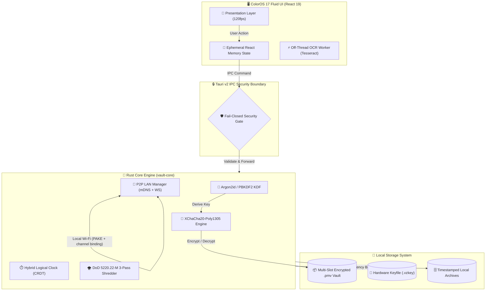

<div align="center">


# 🔒 VaultZero (ভল্টজিরো)
### ColorOS 17 "Living Flow Design" · ১২০fps GPU-ত্বরিত · ১০০% অফলাইন জিরো-নলেজ দুর্গ

**Rust, Tauri 2 ও React 19 দিয়ে তৈরি অতি-দ্রুত, শূন্য-টেলিমেট্রি ডেস্কটপ ও মোবাইল পাসওয়ার্ড ম্যানেজার।**  
*XChaCha20-Poly1305 ও Argon2id এনক্রিপশন · সার্ভার-বিহীন P2P LAN সিঙ্ক · মাস্টার পাসওয়ার্ড রিকভারি উইজার্ড · অফলাইন OCR স্ক্যানার (ইংরেজি + বাংলা) · RFC 6238 2FA TOTP অথেনটিকেটর · ডিজাইনেই এয়ার-গ্যাপড · প্রোসিজিওরাল Lo-Fi সাউন্ডস্কেপ · সম্পূর্ণ English ও বাংলা (নেটিভ বাংলা)।*

---

[](https://github.com/tonmoycoder/VaultZero/releases/latest)
[](https://www.rust-lang.org/)
[](https://v2.tauri.app/)
[](https://react.dev/)
[](https://tailwindcss.com/)
[](./SECURITY.md)
[](./LICENSE)

---

### 🌐 ভাষা নির্বাচন
**[🇬🇧 English Documentation](#-english-documentation)** &nbsp;|&nbsp; **[🇧🇩 বাংলা ডকুমেন্টেশন (Bangla Guide)](#-বাংলা-ডকুমেন্টেশন-bangla-guide)**

</div>

---

## 📥 সরাসরি ডাউনলোড লিংক

> **কোনো ডেভেলপার টুল লাগবে না।** VaultZero **ব্যবহার** করতে Docker, Node.js, Rust, ব্রাউজার বা ইন্টারনেট সংযোগের প্রয়োজন নেই। একটি ফাইল ডাউনলোড করে চালু করুন। দুটো বিল্ডই **স্বতন্ত্র নেটিভ অ্যাপ**: Windows নিজস্ব Tauri/WebView2 উইন্ডো খোলে (কখনোই ব্রাউজার ট্যাব নয়), আর Android সাধারণ APK হিসেবে ইনস্টল হয় নিজস্ব এনক্রিপ্টেড লোকাল ভল্টসহ।

| প্ল্যাটফর্ম | সরাসরি লিংক (সবসময় *latest* রিলিজ) | বিবরণ |
|:---|:---|:---|
| 🪟 **Windows (প্রস্তাবিত)** | [**VaultZero-Windows-x64-Setup.exe**](https://github.com/tonmoycoder/VaultZero/releases/latest/download/VaultZero-Windows-x64-Setup.exe) | NSIS ইনস্টলার; Start-menu + ডেস্কটপ শর্টকাট; আপগ্রেডে ভল্ট অক্ষত থাকে |
| 💼 **Windows portable** | [**VaultZero-Windows-x64-Portable.exe**](https://github.com/tonmoycoder/VaultZero/releases/latest/download/VaultZero-Windows-x64-Portable.exe) | একটি স্বতন্ত্র `.exe`, ইনস্টল ছাড়াই, USB-তে নেওয়া যায় |
| 🏢 **Windows MSI** | [**VaultZero-Windows-x64.msi**](https://github.com/tonmoycoder/VaultZero/releases/latest/download/VaultZero-Windows-x64.msi) | সাইলেন্ট / ম্যানেজড ডিপ্লয়মেন্ট |
| 🤖 **Android (arm64)** | [**VaultZero-Android.apk**](https://github.com/tonmoycoder/VaultZero/releases/latest/download/VaultZero-Android.apk) | সাইন করা রিলিজ APK, সরাসরি ইনস্টলযোগ্য, সম্পূর্ণ অফলাইনে কাজ করে |
| 🔐 **চেকসাম** | [**SHA256SUMS.txt**](https://github.com/tonmoycoder/VaultZero/releases/latest/download/SHA256SUMS.txt) | উপরের **সব** ফাইলের জন্য একটিমাত্র সম্মিলিত `sha256sum` ম্যানিফেস্ট |

এই নামগুলো একটি **স্থিতিশীল চুক্তি**। `.github/workflows/release.yml` প্রতিটি ট্যাগে ঠিক এই ফাইলগুলো তৈরি করে, `README.md` এগুলোর লিংক দেয়, আর ইন-অ্যাপ আপডেটার (`src/lib/updater.ts`) কিছু ইনস্টল করার আগে `SHA256SUMS.txt`-এর সাথে যাচাই করে। Android-এ আপডেটার `.apk`, Windows-এ NSIS `.exe` বেছে নেয় — কখনোই ভুল প্ল্যাটফর্ম নয়।

ম্যানুয়াল ডাউনলোড যাচাই করুন:

```bash
sha256sum -c SHA256SUMS.txt --ignore-missing
```

- 🔗 [**সব রিলিজ ও রিলিজ নোট**](https://github.com/tonmoycoder/VaultZero/releases/latest)
- 📱 Android রিলিজে আর্কাইভের জন্য একটি ভার্সন-নামাঙ্কিত কপিও (`VaultZero-<tag>-Android-arm64.apk`) প্রকাশিত হয়; অ্যাপ ও এই README ব্যবহার করে উপরের স্থিতিশীল URL-টি।

---

## 🖥️ দুটি স্বতন্ত্র অ্যাপ, একটি ঐচ্ছিক সিঙ্ক

Windows ও Android **পরস্পর থেকে স্বাধীন**। প্রতিটি অ্যাপ ডেটা ডিরেক্টরিতে নিজস্ব `local-vault.pmv` তৈরি ও সংরক্ষণ করে, কোনো নেটওয়ার্ক ছাড়াই চলে, এবং অন্য ডিভাইসটি কখনোই চায় না — এটিই fail-closed ডিফল্ট।

দুটোতেই একই ডেটা **চাইলে** **Sync** খুলে P2P LAN সিঙ্ক ব্যবহার করুন: X25519 কী-এক্সচেঞ্জ, ৬-অঙ্কের ephemeral PIN, transcript channel binding ও XChaCha20-Poly1305 এনক্রিপ্টেড পেলোড। **Receive & Merge** আইটেম id দিয়ে local-wins কনফ্লিক্ট সমাধানে মার্জ করে (`src/lib/p2pMerge.ts`), ৮ MB / ৫,০০০ এন্ট্রি / প্রতি ক্ষেত্রে ৪,০৯৬ অক্ষরে সীমাবদ্ধ। কোনো ক্লাউড অ্যাকাউন্ট নেই, সার্ভার নেই, তারে plaintext নেই। QR প্যানেল আসল লাইভ পেয়ারিং কোডের আড়ালে গেট করা — কখনোই নকল প্লেসহোল্ডার কোডকে QR ছবি বানিয়ে দেখায় না।

---

## 🔄 ভল্ট না হারিয়ে স্বয়ংক্রিয় আপডেট

1. চালু হওয়ার সময় অ্যাপ **মূল থ্রেড অলস থাকলে** GitHub রিলিজ চেক করে (প্রথম পেইন্ট আটকায় না) এবং `Update available: vX.Y.Z` দেখায়।
2. **সেটিংস → আপডেট পরীক্ষা করুন** ম্যানুয়াল চেক চালায়; ফলাফল ৫ মিনিট ক্যাশ থাকে, ফলে বারবার ক্লিকে API-তে চাপ পড়ে না।
3. **ডাউনলোড ও ইনস্টল** `github.com` / `objects.githubusercontent.com` থেকে HTTPS-এ অ্যাসেট আনে, স্ট্রিম করে, সাইন করা `SHA256SUMS.txt` ম্যানিফেস্টের বিপরীতে SHA-256 যাচাই করে, **তারপর** Rust `save_update_artifact` IPC কমান্ডে লেখে। অমিল বা অতিরিক্ত আকারের ডাউনলোড বাতিল — **fail closed**, কোনো নকল ফলব্যাক নেই।
4. Windows-এ যাচাইকৃত NSIS ইনস্টলার ব্যাকগ্রাউন্ড থ্রেডে `start /wait` দিয়ে চালু হয়, এবং ইনস্টলার শেষ হওয়ার **পরেই** `AppHandle::restart()` নতুন বিল্ড চালু করে। Android-এ যাচাইকৃত APK অ্যাপ ডেটায় সংরক্ষিত হয় ও তার পাথ দেখানো হয় — Android নীরব APK ইনস্টলেশন দেয় না।
5. ডেটা নিরাপত্তা স্তরে স্তরে: ভল্ট থাকে **অ্যাপ ডেটা ডিরেক্টরিতে**, ইনস্টল ডিরেক্টরিতে নয়, তাই ইনস্টলার এটি ওভাররাইট করতে পারে না। ডাউনলোডের **আগে** (পরে নয়) দ্বিতীয় একটি স্ন্যাপশট নেওয়া হয়; ব্যর্থ আপডেটে কনটেইনার পড়া না গেলে পরের চালুতে `restorePreUpdateBackupIfNeeded()` (`src/lib/updater.ts`) তা ফেরত আনে। স্ন্যাপশট মোছা হয় **কেবল সফল আনলকের পরে**, চালুর সময় নয়।

---

## 🔑 আসল ২FA ও ইমার্জেন্সি কিট

`src/lib/totp.ts` হলো WebCrypto HMAC-SHA1, Base32 সিক্রেট, `otpauth://` URI পার্সিং ও দাপ্তরিক RFC টেস্ট ভেক্টর ব্যবহার করা প্রকৃত RFC 6238 / RFC 4226 ইমপ্লিমেন্টেশন। `VaultItem.totp`-তে থাকে **Base32 সেটআপ কি**; যেকোনো পৃষ্ঠ যেটি *কোড* দেখায় সেটি `useLiveTotpCode()` দিয়ে লাইভ বের করে এবং ৩০-সেকেন্ড পিরিয়ডের সীমানায় রিফ্রেশ হয়। সেটআপ কি কখনোই কোড হিসেবে দেখানো হয় না, "Copy All"-এ (`buildFormattedQuickCopy`) ছাপা হয় না, লগেও যায় না। রিকভারি কোডও বাল্ক কপি থেকে বাদ। সঞ্চিত কি অবৈধ হলে UI কোড আন্দাজ না করে `••• •••` দেখায়।

**ইমার্জেন্সি কিট** (`সেটিংস → টুলস → ইমার্জেন্সি কিট`) একটি প্রিন্টযোগ্য A4 **ফাঁকা টেমপ্লেট**: মাস্টার পাসওয়ার্ডের ইঙ্গিত, ২৪-অক্ষরের রিকভারি কি ও 2FA সেটআপ কি **নিজের হাতে** লিখেন — তাই কোনো গোপন তথ্য প্রিন্টার স্পুলারে যায় না বা অ্যাপ ডিস্কে লেখে না। প্রতিটি কিট পায় আলাদা CSPRNG ডকুমেন্ট আইডি। ভল্ট ফেরত পেতে লক স্ক্রিনের **Recovery Key** উইজার্ড ব্যবহার করুন — কিটটি একটি অফলাইন স্মরণিকা, আলাদা কোনো এনক্রিপ্টেড ফাইল ফরম্যাট নয়।

---

## ⚡ কোল্ড স্টার্ট, ফিজিক্স ও কমপ্লেক্সিটি

- `.exe` ব্রাউজার ট্যাব, ডেভ সার্ভার বা স্টার্টআপ নেটওয়ার্ক রিকোয়েস্ট ছাড়াই নেটিভ Tauri উইন্ডো খোলে। রিলিজ চেক `requestIdleCallback`-এ সরিয়ে রাখা হয়েছে; Web Audio / Lo-Fi ইঞ্জিন `React.lazy` দিয়ে কেবল zen মোড খুললে লোড হয়। প্রধান JS চাঙ্ক `scripts/check-bundle-size.mjs` দিয়ে নিয়ন্ত্রিত।
- ColorOS-ধাঁচের ফিজিক্স মাপা হয়, নকল নয়: `src/lib/gesturePhysics.ts` বাস্তব পয়েন্টার স্যাম্পল থেকে গতি বের করে (`speedFromSamples`), ক্ল্যাম্প করে, `rubberBand` রেজিস্ট্যান্স ও `speedResponsiveSpring` প্রয়োগ করে, এবং শেষ রিবাউন্ড `data-elastic-state` / `data-last-rebound`-এ রাখে। খুব দ্রুত কিন্তু ক্ষুদ্র ফ্লিক আর পুরো শিট ছুঁড়ে ফেলতে পারে না, এবং ড্র্যাগের পর হ্যান্ডেলের ক্লিক দমন করা হয় — ফলে মৃদু আংশিক ড্র্যাগ সবসময় ফিরে আসে।
- হট পাথের কমপ্লেক্সিটি (পূর্ণ বিশ্লেষণ `docs/AUDIT-2026-11.md`-এ): সার্চ `n` আইটেম ও কোয়েরির `m` অক্ষরে `O(n·m)` সময় / `O(1)` অতিরিক্ত মেমরি; P2P মার্জ একটিমাত্র id-union পাসে `O(n+m)` সময় / `O(n+m)` মেমরি; CRDT ক্লক একটি saturating `AtomicU64` CAS-এ `O(1)` সময় ও মেমরি; TOTP প্রতি কোডে (একটি HMAC) `O(1)` সময় ও মেমরি; আপডেটার `O(1)` বাফারে স্ট্রিম করে `O(size)` ডিস্ক I/O করে ও ডাইজেস্ট ধাপে ধাপে যাচাই করে।

---

## ✅ চেকআউট যাচাই

```bash
npm ci
npx tsc --noEmit
npm run verify                 # harness tests, contrast, rustfmt, bundle budget
npx playwright test           # full end-to-end suite
npm audit --audit-level=high
cargo test --package vault-core
cargo clippy --all-targets -- -D warnings
```

CI Rust গেটগুলো `windows-latest`-এ এবং Playwright সুইট `ubuntu-latest`-এ চালায়; রিলিজ ওয়ার্কফ্লো একই কমিট থেকে NSIS/MSI Windows বাইনারি ও সাইন করা Android APK তৈরি করে।


# 🇬🇧 English Documentation

## 🌟 Overview

**VaultZero** is an open-source, air-gapped password manager and zero-knowledge digital vault engineered from the ground up for individuals and organizations demanding uncompromising cryptographic privacy without surrendering keys to centralized cloud corporations.

---

## 🛡️ Unhackable Threat Model & Cryptographic Guarantees

VaultZero operates on an unhackable **Fail-Closed Air-Gapped Security Architecture**:

| Security Layer | Cryptographic Specification | Attack Resistance |
|:---|:---|:---|
| **Key Derivation (KDF)** | **Argon2id** (Memory-hard: 64 MiB RAM, 3 iterations, 4 parallelism lanes) | ASIC, GPU cluster, and FPGA brute-force dictionary immunity |
| **Symmetric Cipher** | **XChaCha20-Poly1305** (256-bit key, 192-bit extended nonce) | Quantum-resistant stream cipher, zero nonce-reuse vulnerability |
| **Envelope Architecture** | **Multi-Slot AAD Header Masking** (`.pmv` format) | Tamper-evident authenticated data; bit-flip attempts immediately fail-closed |
| **Zero-Knowledge Memory** | **Memory Zeroization & DoD 5220.22-M 3-Pass Shredder** | Cold-boot memory scraping and forensic disk carving defense |
| **P2P Transport** | **PAKE-style Handshake + Transcript Channel Binding + XChaCha20-Poly1305** | Active Man-in-the-Middle (MitM) rejection across untrusted Wi-Fi; payload never leaves the host in cleartext |
| **System Boundary** | **Fail-Closed IPC Gate (Rust 🦀)** | Strict boundary isolation; renderer compromises cannot extract plaintext |

---

## 🚀 Core Features Matrix (v2.5.0)

### 1. 📡 Military-Grade P2P LAN Sync (Zero Cloud)
*   **Serverless Local Transfer:** Sync credentials between desktop and mobile devices over local Wi-Fi without any third-party cloud servers.
*   **mDNS Auto-Discovery:** Broadcasts on `_vaultzero._tcp.local.` with ephemeral socket binding.
*   **Constant-Time Ephemeral PIN:** High-security 6-digit ephemeral pairing with `subtle::ConstantTimeEq` timing-attack mitigation, bound into the key schedule before the shared secret is used.
*   **Authenticated Key Exchange:** X25519 ephemeral exchange with a **transcript channel-binding hash** that both peers must verify — a man-in-the-middle that substitutes a key is rejected before any vault data is released.
*   **Encrypted Payload:** The vault snapshot is sealed with XChaCha20-Poly1305 (direction-separated keys) *before* it reaches the socket. Plaintext never crosses the wire.
*   **Encrypted-Only Transmission:** Plaintext never crosses the network wire; only authenticated, encrypted `.pmv` payloads are transferred.

### 2. 🎨 ColorOS 17 "Living Flow Design" (120fps UI)
*   **Lag-Free 120Hz Animations:** GPU-accelerated fluid cubic-bezier curves (`--ease-out-fluid`, `--ease-in-out-flow`).
*   **Isolated TOTP Ticker (`React.memo`):** Micro-component countdown boundaries isolate 1-second interval updates, preventing dashboard re-renders and frame drops.
*   **Tactile Micro-Haptics:** Interactive scale springs (`whileHover: scale 1.012`, `whileTap: scale 0.965`).
*   **Canvas Throttling:** 30fps background audio visualizer throttler with automatic tab pause guard.

### 3. 🔍 Zero-API Offline OCR (Tesseract in Web Worker)
*   **100% Offline Credential Extraction:** Bundled `eng.traineddata` (English) and `ben.traineddata` (বাংলা) directly inside `public/tessdata/`.
*   **Off-Thread Web Worker:** Executes image recognition in a background worker thread (`src/workers/ocr.worker.ts`), keeping the UI responsive at 120fps.
*   **Smart Regex Entity Classification:** Automatically parses and assigns URLs, usernames, passwords, and 2FA secrets without external API calls.

### 4. 🔑 Master Password Recovery & Keyfile Wizard
*   **24-Character Recovery Key (`VZRO-XXXX-XXXX-XXXX-XXXX-XXXX`):** Cryptographically unwraps the vault using an independent recovery KEK slot if the master password is forgotten.
*   **Hardware Keyfile (`.vzkey`):** Generates 32 bytes of CSPRNG hardware entropy for air-gapped two-factor vault locking.
*   **Safe Emergency Reset:** Guaranteed zero accidental data loss; creates a timestamped archive (`vaultzero_archived_<timestamp>`) before initializing a clean vault.

### 5. 🛡️ Zero-Knowledge Breach Scanner
*   **Offline K-Anonymity Checks:** SHA-1 prefix matching via local Bloom filters; checks password breach exposure without exposing any password bits to third parties.

---

## 🏛️ System Architecture Workflow



---

## 💻 Developer & Source Build Guide

```bash
# 1. Clone the repository
git clone https://github.com/tonmoycoder/VaultZero.git
cd VaultZero

# 2. Install frontend dependencies
npm install

# 3. Start local development server (Port 1420)
npm run dev

# 4. Run automated tests (Rust core + Playwright)
cargo test --package vault-core
npx playwright test

# 5. Build production Windows binary
npm run build
npx tauri build
```

---

# 🇧🇩 বাংলা ডকুমেন্টেশন (Bangla Guide)

## 🌟 পরিচিতি

**ভল্টজিরো (VaultZero)** হলো ১০০% অফলাইন, জিরো-নলেজ ও অত্যন্ত দ্রুতগতির ডেস্কটপ ও মোবাইল পাসওয়ার্ড ম্যানেজার। ক্লাউড সার্ভারের ওপর নির্ভরশীল পাসওয়ার্ড ম্যানেজারগুলোর নিরাপত্তা ঝুঁকি দূর করতে এটি আপনার ডিভাইসেই মিলিটারি-গ্রেড ক্রিপ্টোগ্রাফিতে সমস্ত ডেটা নিরাপদে সংরক্ষণ করে।

> **সাধারণ ব্যবহারকারীদের জন্য বিশেষ দ্রষ্টব্য:** ভল্টজিরো ব্যবহার করার জন্য Docker, Node.js, Rust বা ব্রাউজারের প্রয়োজন নেই। উইন্ডোজে [`.exe`](https://github.com/tonmoycoder/VaultZero/releases/latest/download/VaultZero-Windows-x64-Setup.exe) এবং অ্যান্ড্রয়েডে [`.apk`](https://github.com/tonmoycoder/VaultZero/releases/latest/download/VaultZero-Android.apk) ডাউনলোড করলেই হলো — দুটিই সম্পূর্ণ স্বতন্ত্র নেটিভ অ্যাপ, ব্রাউজার ট্যাব নয়।

---

## ✨ প্রধান প্রযুক্তিগত সুবিধাসমূহ (v2.5.0)

1. **মিলিটারি-গ্রেড লোকাল P2P সিঙ্ক (P2P LAN Sync):**
   - ক্লাউড সার্ভার ছাড়া লোকাল ওয়াই-ফাইয়ের মাধ্যমে ডেস্কটপ ও মোবাইলের মাঝে নিরাপদ ভল্ট সিঙ্ক।
   - ৬-ডিজিটের এফিমোরাল পিন এবং কনস্ট্যান্ট-টাইম অথেন্টিকেশনের মাধ্যমে ম্যান-ইন-দ্য-মিডল অ্যাটাক থেকে সম্পূর্ণ নিরাপদ।
   - নেটওয়ার্কে কখনোই প্লেইনটেক্সট পাঠানো হয় না; শুধুমাত্র এনক্রিপ্টেড `.pmv` পেলোড আদান-প্রদান করা হয়।

2. **ColorOS 17 "লিভিং ফ্লো ডিজাইন" (১২০fps UI):**
   - স্প্রিং ফিজিক্স ও ফ্লুইড অ্যানিমেশন।
   - প্রতি সেকেন্ডের কাউন্টডাউন টিক ড্যাশবোর্ডকে রি-রেন্ডার করে না, ফলে ১২০ হার্টজ রিফ্রেশ রেটেও একটানা মসৃণ পারফরম্যান্স পাওয়া যায়।

3. **জিরো-এপিআই অফলাইন ওসিআর (OCR):**
   - ইংরেজি এবং বাংলা উভয় ভাষার জন্য লোকাল ডেটা ফাইল (`eng.traineddata` ও `ben.traineddata`) সরাসরি অ্যাপে অন্তর্ভুক্ত।
   - ওয়েব ওয়ার্কারের মাধ্যমে অফ-থ্রেডে ইমেজ প্রসেসিং চলায় অ্যাপ একটুও স্লো বা হ্যাং হয় না।

4. **মাস্টার পাসওয়ার্ড রিকভারি ও কি-ফাইল উইজার্ড:**
   - **২৪ অক্ষরের রিকভারি কি (`VZRO-...`):** পাসওয়ার্ড ভুলে গেলেও ভল্ট সুরক্ষিতভাবে আনলক করে নতুন পাসওয়ার্ড সেট করা যায়।
   - **হার্ডওয়্যার কি-ফাইল (`.vzkey`):** ৩২-বাইট র্যান্ডম কি-ফাইলের সাহায্যে টু-ফ্যাক্টর অফলাইন সুরক্ষা।
   - **জিরো ডেটা লস গ্যারান্টি:** যেকোনো বড় পরিবর্তনের আগে স্বয়ংক্রিয় টাইমস্ট্যাম্পড লোকাল ব্যাকআপ তৈরি হয়।

5. **জিরো-নলেজ ব্রিচ স্ক্যানার:**
   - পাসওয়ার্ড হ্যাক হয়েছে কিনা তা অফলাইনে স্থানীয় ব্লুম ফিল্টারের সাহায্যে পরীক্ষা করা যায়।

---

## 📖 ব্যবহার নির্দেশিকা (Quickstart)

১. **অ্যাপটি চালু করুন:** উইন্ডোজে `VaultZero-Windows-x64-Setup.exe` ইনস্টল করুন অথবা `VaultZero-Windows-x64-Portable.exe`-এ ডাবল ক্লিক করুন; অ্যান্ড্রয়েডে `VaultZero-Android.apk` ইনস্টল করুন।  
২. **মাস্টার পাসওয়ার্ড সেট করুন:** একটি শক্তিশালী পাসওয়ার্ড নির্ধারণ করুন (প্রয়োজনে অতিরিক্ত সুরক্ষার জন্য `.vzkey` তৈরি করুন)।  
৩. **ইমার্জেন্সি রিকভারি কি সংরক্ষণ করুন:** পর্দায় প্রদর্শিত ২৪-অক্ষরের `VZRO-...` কোডটি নিরাপদ স্থানে লিখে রাখুন।  
৪. **পাসওয়ার্ড যোগ বা ইম্পোর্ট করুন:** **+ নতুন যোগ করুন** বাটনে চাপুন অথবা Chrome/Bitwarden থেকে সরাসরি CSV ফাইল ইম্পোর্ট করুন।  
৫. **প্যানিক লক:** যেকোনো সময় কিবোর্ডে `Ctrl + L` চাপলে র‍্যামের সমস্ত এনক্রিপশন কি ডিলিট হয়ে ভল্ট তৎক্ষণাৎ লক হয়ে যাবে।

---

## 📜 লাইসেন্স ও নিরাপত্তা (License & Security)

- **লাইসেন্স:** এই প্রজেক্টটি পারমিসিভ [MIT License](./LICENSE)-এর অধীনে উন্মুক্ত।
- **নিরাপত্তা পলিসি:** যেকোনো নিরাপত্তা পর্যালোচনা বা দায়িত্বশীল প্রকাশের জন্য [SECURITY.md](./SECURITY.md) দেখুন।

---

## 🔄 আপডেট ও ডেটা নিরাপত্তা (বাংলা)

নতুন রিলিজ বের হলে অ্যাপ নিজে GitHub থেকে জানায়; **সেটিংস → Check for Updates** থেকেও ম্যানুয়ালিভাবেও চেক করা যায়। ডাউনলোডযোগ্য ফাইলটি `SHA256SUMS.txt` দিয়ে যাচাই না হওয়া পর্যন্ত ইনস্টল হয় না। উইন্ডোজে ইনস্টলার শেষ হলে অ্যাপ নিজে আবার চালু হয়; অ্যান্ড্রয়েডে যাচাইকৃত APK অ্যাপের ডেটা ফোল্ডারে সংরক্ষিত হয় (অ্যান্ড্রয়েড নীরবে APK ইনস্টল করতে দেয় না)।

আপনার ভল্ট `local-vault.pmv` ফাইলে **অ্যাপ ডেটা ফোল্ডারে** থাকে, ইনস্টল ফোল্ডারে নয় — তাই আপডেট কখনোই পুরনো ডেটা মুছে দেয় না। আপডেটের আগে আরও একটি এনক্রিপ্টেড স্ন্যাপশট নেওয়া হয়; কোনো কারণে ভল্ট পড়া না গেলে পরের চালুতে সেটি স্বয়ংক্রিয়ভাবে ফেরত আনা হয়, এবং **সফল আনলকের পরেই** কেবল স্ন্যাপশট মোছা হয়।

## 🔑 ২FA ও ইমার্জেন্সি কিট (বাংলা)

২FA আসল RFC 6238 ইঞ্জিন: Base32 সেটআপ কি থেকে WebCrypto HMAC দিয়ে প্রতি ৩০ সেকেন্ডে নতুন কোড তৈরি হয়। সেটআপ কি কখনো কোড হিসেবে দেখানো হয় না, **Copy All**-এ যায় না, লগেও লেখা হয় না। ভুল কি থাকলে কোডের জায়গায় `••• •••` দেখায় — কোনো অনুমান নয়।

**ইমার্জেন্সি কিট** একটি হাতে-লেখা A4 ছক: মাস্টার পাসওয়ার্ড, ২৪-অক্ষরের রিকভারি কি ও ২FA কি আপনি নিজে লিখেন, তাই অ্যাপ কোনো গোপন তথ্য প্রিন্টারে বা ডিস্কে লেখে না। প্রতিটি কিটের নিজস্ব র্যান্ডম ডকুমেন্ট আইডি থাকে। ভল্ট ফিরে পেতে লক স্ক্রিনের **"পাসওয়ার্ড ভুলে গেছেন? ভল্ট রিকভার করুন"** পথে রিকভারি কি ব্যবহার করুন।

## 📥 সরাসরি ডাউনলোড (বাংলা)

| প্ল্যাটফর্ম | লিংক |
|:---|:---|
| 🪟 উইন্ডোজ ইনস্টলার | [VaultZero-Windows-x64-Setup.exe](https://github.com/tonmoycoder/VaultZero/releases/latest/download/VaultZero-Windows-x64-Setup.exe) |
| 💼 উইন্ডোজ পোর্টেবল | [VaultZero-Windows-x64-Portable.exe](https://github.com/tonmoycoder/VaultZero/releases/latest/download/VaultZero-Windows-x64-Portable.exe) |
| 🤖 অ্যান্ড্রয়েড APK | [VaultZero-Android.apk](https://github.com/tonmoycoder/VaultZero/releases/latest/download/VaultZero-Android.apk) |
| 🔐 চেকসাম | [SHA256SUMS.txt](https://github.com/tonmoycoder/VaultZero/releases/latest/download/SHA256SUMS.txt) |
