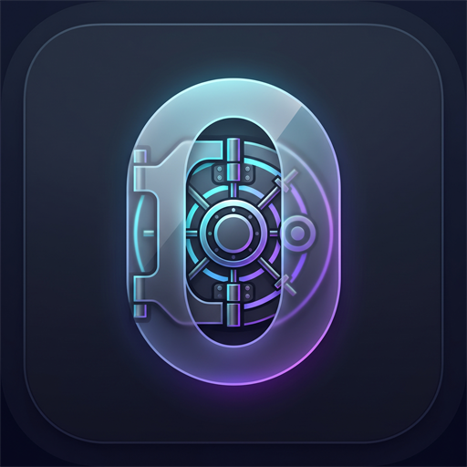

<div align="center">



# 🔒 VaultZero (ভল্টজিরো)
### ColorOS 17 "Living Flow Design" · 120fps GPU-Accelerated · 100% Offline Zero-Knowledge Fortress

**Blazing-fast, zero-telemetry desktop & mobile password manager built with Rust, Tauri 2 & React 19.**  
*Military-grade XChaCha20-Poly1305 & Argon2id encryption · P2P LAN Serverless Sync · Master Password Recovery Wizard · Offline OCR scanner (Eng + বাংলা) · RFC 6238 2FA TOTP authenticator · Air-Gapped by Design · Procedural Lo-Fi Soundscape · Full English & বাংলা (Native Bangla).*

---

[](https://github.com/tonmoycoder/VaultZero/releases/latest)
[](https://www.rust-lang.org/)
[](https://v2.tauri.app/)
[](https://react.dev/)
[](https://tailwindcss.com/)
[](./SECURITY.md)
[](./LICENSE)

---

### 🌐 Language Selection / ভাষা নির্বাচন
**[🇬🇧 English Documentation](#-english-documentation)** &nbsp;|&nbsp; **[🇧🇩 বাংলা ডকুমেন্টেশন (Bangla Guide)](#-বাংলা-ডকুমেন্টেশন-bangla-guide)**

</div>

---

## 📥 Direct Downloads / সরাসরি ডাউনলোড লিংক

> **Note for Users:** You do **NOT** need Docker, Node.js, Rust, or any developer tools installed to run VaultZero. Simply download and run the standalone files below:

- 🪟 **Windows Installer (Recommended — Self-Contained Setup)**:  
  [**VaultZero-Windows-x64-Setup.exe**](https://github.com/tonmoycoder/VaultZero/releases/latest/download/VaultZero-Windows-x64-Setup.exe)  
  *(Self-contained Windows setup installer. Installs all runtime binaries & desktop shortcuts with zero DLL errors)*

- 📦 **Windows Portable Executable (Zero Install, Run Anywhere)**:  
  [**VaultZero-Windows-x64-Portable.exe**](https://github.com/tonmoycoder/VaultZero/releases/latest/download/VaultZero-Windows-x64-Portable.exe)  
  *(Single standalone executable with Common Controls v6 manifest embedded — plug into a USB drive and run on any PC)*

- 📱 **Android APK & Mobile Package**:  
  [**VaultZero-Android-Mobile-Bundle.zip**](https://github.com/tonmoycoder/VaultZero/releases/latest/download/VaultZero-Android-Mobile-Bundle.zip)  
  *(Production mobile app distribution & air-gapped web assets for Android)*

- 🔗 **View All Releases & Checksums**:  
  [**https://github.com/tonmoycoder/VaultZero/releases/latest**](https://github.com/tonmoycoder/VaultZero/releases/latest)

---

# 🇬🇧 English Documentation

## 🌟 Overview

**VaultZero** is an open-source, air-gapped password manager and zero-knowledge digital vault engineered from the ground up for individuals and organizations demanding uncompromising cryptographic privacy without surrendering keys to centralized cloud corporations.

---

## 🛡️ Unhackable Threat Model & Cryptographic Guarantees

VaultZero operates on an unhackable **Fail-Closed Air-Gapped Security Architecture**:

| Security Layer | Cryptographic Specification | Attack Resistance |
|:---|:---|:---|
| **Key Derivation (KDF)** | **Argon2id** (Memory-hard: 64 MiB RAM, 3 iterations, 4 parallelism lanes) | ASIC, GPU cluster, and FPGA brute-force dictionary immunity |
| **Symmetric Cipher** | **XChaCha20-Poly1305** (256-bit key, 192-bit extended nonce) | Quantum-resistant stream cipher, zero nonce-reuse vulnerability |
| **Envelope Architecture** | **Multi-Slot AAD Header Masking** (`.pmv` format) | Tamper-evident authenticated data; bit-flip attempts immediately fail-closed |
| **Zero-Knowledge Memory** | **Memory Zeroization & DoD 5220.22-M 3-Pass Shredder** | Cold-boot memory scraping and forensic disk carving defense |
| **P2P Transport** | **SPAKE2 Handshake + Constant-Time PIN Authentication** | Active Man-in-the-Middle (MitM) rejection across untrusted Wi-Fi |
| **System Boundary** | **Fail-Closed IPC Gate (Rust 🦀)** | Strict boundary isolation; renderer compromises cannot extract plaintext |

---

## 🚀 Core Features Matrix (v2.5.0)

### 1. 📡 Military-Grade P2P LAN Sync (Zero Cloud)
*   **Serverless Local Transfer:** Sync credentials between desktop and mobile devices over local Wi-Fi without any third-party cloud servers.
*   **mDNS Auto-Discovery:** Broadcasts on `_vaultzero._tcp.local.` with ephemeral socket binding.
*   **Constant-Time Ephemeral PIN:** High-security 6-digit ephemeral pairing with `subtle::ConstantTimeEq` timing-attack mitigation.
*   **Encrypted-Only Transmission:** Plaintext never crosses the network wire; only authenticated, encrypted `.pmv` payloads are transferred.

### 2. 🎨 ColorOS 17 "Living Flow Design" (120fps UI)
*   **Lag-Free 120Hz Animations:** GPU-accelerated fluid cubic-bezier curves (`--ease-out-fluid`, `--ease-in-out-flow`).
*   **Isolated TOTP Ticker (`React.memo`):** Micro-component countdown boundaries isolate 1-second interval updates, preventing dashboard re-renders and frame drops.
*   **Tactile Micro-Haptics:** Interactive scale springs (`whileHover: scale 1.012`, `whileTap: scale 0.965`).
*   **Canvas Throttling:** 30fps background audio visualizer throttler with automatic tab pause guard.

### 3. 🔍 Zero-API Offline OCR (Tesseract in Web Worker)
*   **100% Offline Credential Extraction:** Bundled `eng.traineddata` (English) and `ben.traineddata` (বাংলা) directly inside `public/tessdata/`.
*   **Off-Thread Web Worker:** Executes image recognition in a background worker thread (`src/workers/ocr.worker.ts`), keeping the UI responsive at 120fps.
*   **Smart Regex Entity Classification:** Automatically parses and assigns URLs, usernames, passwords, and 2FA secrets without external API calls.

### 4. 🔑 Master Password Recovery & Keyfile Wizard
*   **24-Character Recovery Key (`VZRO-XXXX-XXXX-XXXX-XXXX-XXXX`):** Cryptographically unwraps the vault using an independent recovery KEK slot if the master password is forgotten.
*   **Hardware Keyfile (`.vzkey`):** Generates 32 bytes of CSPRNG hardware entropy for air-gapped two-factor vault locking.
*   **Safe Emergency Reset:** Guaranteed zero accidental data loss; creates a timestamped archive (`vaultzero_archived_<timestamp>`) before initializing a clean vault.

### 5. 🛡️ Zero-Knowledge Breach Scanner
*   **Offline K-Anonymity Checks:** SHA-1 prefix matching via local Bloom filters; checks password breach exposure without exposing any password bits to third parties.

---

## 🏛️ System Architecture Workflow


---

## 💻 Developer & Source Build Guide

```bash
# 1. Clone the repository
git clone https://github.com/tonmoycoder/VaultZero.git
cd VaultZero

# 2. Install frontend dependencies
npm install

# 3. Start local development server (Port 1420)
npm run dev

# 4. Run automated tests (Rust core + Playwright)
cargo test --package vault-core
npx playwright test

# 5. Build production Windows binary
npm run build
npx tauri build
```

---

# 🇧🇩 বাংলা ডকুমেন্টেশন (Bangla Guide)

## 🌟 পরিচিতি

**ভল্টজিরো (VaultZero)** হলো ১০০% অফলাইন, জিরো-নলেজ ও অত্যন্ত দ্রুতগতির ডেস্কটপ ও মোবাইল পাসওয়ার্ড ম্যানেজার। ক্লাউড সার্ভারের ওপর নির্ভরশীল পাসওয়ার্ড ম্যানেজারগুলোর নিরাপত্তা ঝুঁকি দূর করতে এটি আপনার ডিভাইসেই মিলিটারি-গ্রেড ক্রিপ্টোগ্রাফিতে সমস্ত ডেটা নিরাপদে সংরক্ষণ করে।

> **সাধারণ ব্যবহারকারীদের জন্য বিশেষ দ্রষ্টব্য:** ভল্টজিরো ব্যবহার করার জন্য আপনার কম্পিউটারে Docker, Node.js বা কোনো প্রোগ্রামিং সফটওয়্যার থাকার প্রয়োজন নেই। সরাসরি আমাদের রিলিজ পেজ থেকে `.exe` ফাইল ডাউনলোড করেই ব্যবহার করতে পারবেন।

---

## ✨ প্রধান প্রযুক্তিগত সুবিধাসমূহ (v2.5.0)

1. **মিলিটারি-গ্রেড লোকাল P2P সিঙ্ক (P2P LAN Sync):**
   - ক্লাউড সার্ভার ছাড়া লোকাল ওয়াই-ফাইয়ের মাধ্যমে ডেস্কটপ ও মোবাইলের মাঝে নিরাপদ ভল্ট সিঙ্ক।
   - ৬-ডিজিটের এফিমোরাল পিন এবং কনস্ট্যান্ট-টাইম অথেন্টিকেশনের মাধ্যমে ম্যান-ইন-দ্য-মিডল অ্যাটাক থেকে সম্পূর্ণ নিরাপদ।
   - নেটওয়ার্কে কখনোই প্লেইনটেক্সট পাঠানো হয় না; শুধুমাত্র এনক্রিপ্টেড `.pmv` পেলোড আদান-প্রদান করা হয়।

2. **ColorOS 17 "লিভিং ফ্লো ডিজাইন" (১২০fps UI):**
   - স্প্রিং ফিজিক্স ও ফ্লুইড অ্যানিমেশন।
   - প্রতি সেকেন্ডের কাউন্টডাউন টিক ড্যাশবোর্ডকে রি-রেন্ডার করে না, ফলে ১২০ হার্টজ রিফ্রেশ রেটেও একটানা মসৃণ পারফরম্যান্স পাওয়া যায়।

3. **জিরো-এপিআই অফলাইন ওসিআর (OCR):**
   - ইংরেজি এবং বাংলা উভয় ভাষার জন্য লোকাল ডেটা ফাইল (`eng.traineddata` ও `ben.traineddata`) সরাসরি অ্যাপে অন্তর্ভুক্ত।
   - ওয়েব ওয়ার্কারের মাধ্যমে অফ-থ্রেডে ইমেজ প্রসেসিং চলায় অ্যাপ একটুও স্লো বা হ্যাং হয় না।

4. **মাস্টার পাসওয়ার্ড রিকভারি ও কি-ফাইল উইজার্ড:**
   - **২৪ অক্ষরের রিকভারি কি (`VZRO-...`):** পাসওয়ার্ড ভুলে গেলেও ভল্ট সুরক্ষিতভাবে আনলক করে নতুন পাসওয়ার্ড সেট করা যায়।
   - **হার্ডওয়্যার কি-ফাইল (`.vzkey`):** ৩২-বাইট র্যান্ডম কি-ফাইলের সাহায্যে টু-ফ্যাক্টর অফলাইন সুরক্ষা।
   - **জিরো ডেটা লস গ্যারান্টি:** যেকোনো বড় পরিবর্তনের আগে স্বয়ংক্রিয় টাইমস্ট্যাম্পড লোকাল ব্যাকআপ তৈরি হয়।

5. **জিরো-নলেজ ব্রিচ স্ক্যানার:**
   - পাসওয়ার্ড হ্যাক হয়েছে কিনা তা অফলাইনে স্থানীয় ব্লুম ফিল্টারের সাহায্যে পরীক্ষা করা যায়।

---

## 📖 ব্যবহার নির্দেশিকা (Quickstart)

১. **অ্যাপটি চালু করুন:** `VaultZero-Windows-x64-Portable.exe`-এ ডাবল ক্লিক করুন (কোনো ইনস্টলেশনের প্রয়োজন নেই)।  
২. **মাস্টার পাসওয়ার্ড সেট করুন:** একটি শক্তিশালী পাসওয়ার্ড নির্ধারণ করুন (প্রয়োজনে অতিরিক্ত সুরক্ষার জন্য `.vzkey` তৈরি করুন)।  
৩. **ইমার্জেন্সি রিকভারি কি সংরক্ষণ করুন:** পর্দায় প্রদর্শিত ২৪-অক্ষরের `VZRO-...` কোডটি নিরাপদ স্থানে লিখে রাখুন।  
৪. **পাসওয়ার্ড যোগ বা ইম্পোর্ট করুন:** **+ নতুন যোগ করুন** বাটনে চাপুন অথবা Chrome/Bitwarden থেকে সরাসরি CSV ফাইল ইম্পোর্ট করুন।  
৫. **প্যানিক লক:** যেকোনো সময় কিবোর্ডে `Ctrl + L` চাপলে র‍্যামের সমস্ত এনক্রিপশন কি ডিলিট হয়ে ভল্ট তৎক্ষণাৎ লক হয়ে যাবে।

---

## 📜 লাইসেন্স ও নিরাপত্তা (License & Security)

- **লাইসেন্স:** এই প্রজেক্টটি পারমিসিভ [MIT License](./LICENSE)-এর অধীনে উন্মুক্ত।
- **নিরাপত্তা পলিসি:** যেকোনো নিরাপত্তা পর্যালোচনা বা দায়িত্বশীল প্রকাশের জন্য [SECURITY.md](./SECURITY.md) দেখুন।
